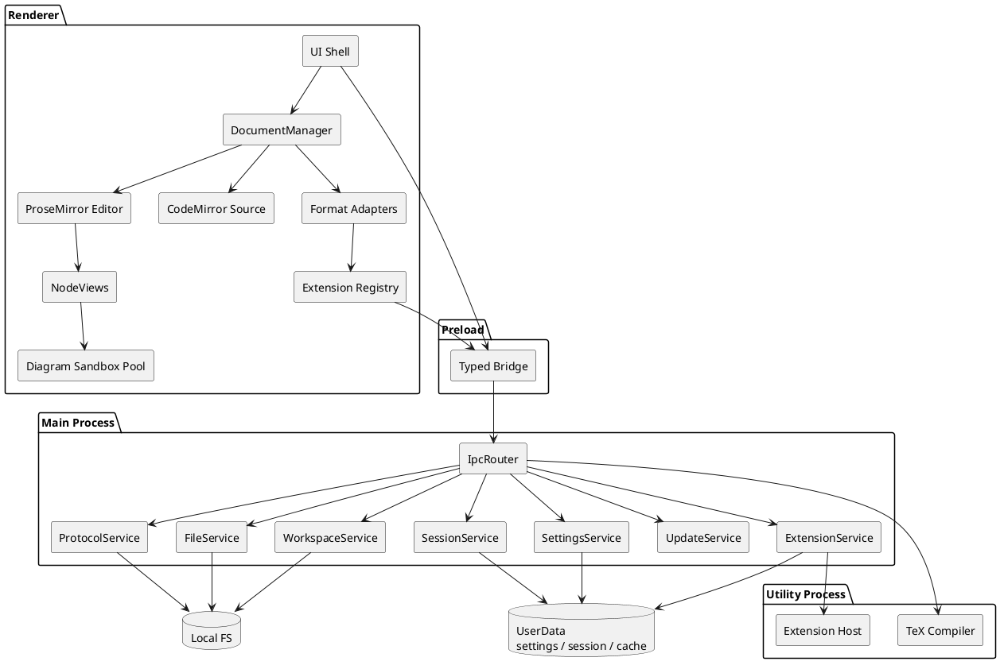
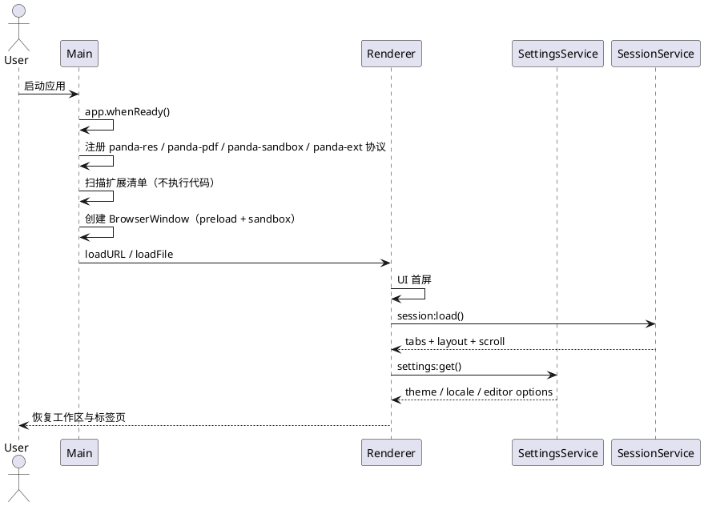
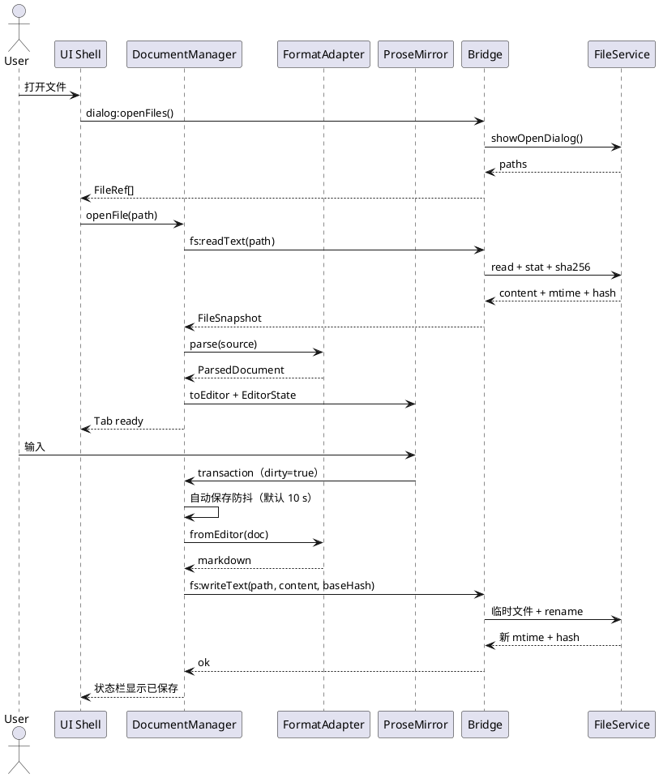
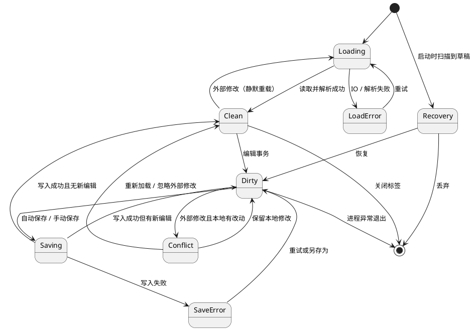
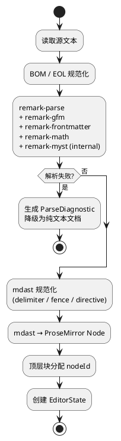
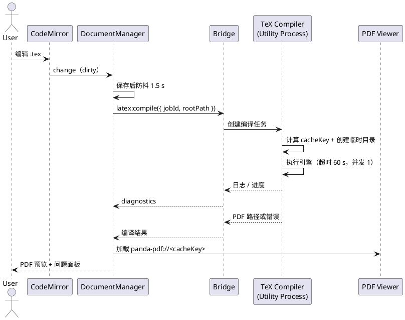

# Panda Live 设计文档

| 项目 | 内容 |
|---|---|
| 文档版本 | 0.1 |
| 状态 | 评审中 |
| 更新日期 | 2026-11-08 |
| 适用版本 | v1.0 |
| 参考实现 | `workspace/markdown-viewer`（渲染能力与 Electron 集成参考） |

阅读约定：

- **MUST** 为验收项，**SHOULD** 为可降级项。
- 文中“渲染态”指用户最终看到的排版结果，“源码态”指原始文本。
- 术语首次出现给出英文。

---

## 1. 项目概述

### 1.1 产品定位

Panda Live 是本地优先的桌面文档编辑器，核心特征是**编辑区即渲染结果**。v1 以 Markdown 为主格式，支持 LaTeX 数学、MathML、PlantUML/Mermaid 图表及 MyST 扩展指令；同一文档可在所见即所得（WYSIWYG）与源码模式之间切换。

### 1.2 v1 能力范围

| 能力 | 编辑方式 | 渲染方式 |
|---|---|---|
| Markdown（GFM + frontmatter + 表格 + 任务列表） | WYSIWYG（ProseMirror）；源码模式为完整代码编辑器（CodeMirror 6） | 编辑器内直接排版 |
| LaTeX 数学公式 | WYSIWYG 公式节点（MathLive 编辑） | KaTeX 静态渲染 |
| MathML | XML 源码编辑（代码编辑器，XML 高亮） | Chromium MathML Core 原生渲染 |
| PlantUML / Mermaid | 图表节点内源码编辑 | 隐藏 iframe 沙箱渲染为 SVG |
| MyST 指令（`tab-set` / `tab-item` / `grid` / `grid-item`） | WYSIWYG 容器节点 | 自定义 NodeView |
| `.tex` 文档 | 源码编辑（完整代码编辑器） | 外部引擎编译 PDF（可选能力） |
| 工作区、多标签、会话恢复、查找替换、导出 HTML/PDF | — | — |
| 扩展系统（新增文件格式、语言、渲染器、命令） | 清单声明 + 扩展宿主 | 内置格式与第三方扩展共用注册路径 |

### 1.3 非目标

- 实时协作、云端同步、账号体系。
- 完整 `.tex` 文档的 WYSIWYG 排版（v1 为源码 + 编译预览，见 §9.5）。
- Word/PDF 反向导入。
- 移动端与浏览器独立版本。
- v1 不提供在线扩展市场；仅支持本地 `.panda` 扩展安装与启用（见 §7.6）。
- 源码面板不做十六进制/二进制编辑，不提供 LSP/语言服务器与跨文件语义补全。

### 1.4 前置假设

- 目标平台：Windows、macOS、Linux。
- 文档以 UTF-8 为主；其他编码按只读打开并提示（v1 不提供转码）。
- 除首次使用 `.tex` 编译需下载 TeX bundle 外，应用可完全离线运行。
- 单窗口多标签；多窗口后续版本再评估。

### 1.5 与参考实现的关系

| `markdown-viewer` 现状 | 本设计处理 |
|---|---|
| `textarea` + 预览 | 替换为 ProseMirror WYSIWYG；源码模式改用 CodeMirror 6 |
| `marked` + KaTeX 扩展 | 替换为 remark/mdast，保留 AST 与源位置 |
| MyST 正则预处理 | 改为解析后的 mdast 转换，避免围栏正则误判 |
| PlantUML 在主线程渲染 | 改为隐藏 iframe 沙箱池 + 结果缓存 |
| IPC 直接暴露多组文件操作 | 保留能力，改为类型化契约 + zod 校验 |
| CDN 加载 Prism、Beautify 等脚本 | 全部本地打包，保证离线可用 |
| 单文件约 5000 行 | 按编辑器 / 格式 / 渲染 / 平台分层 |

---

## 2. 术语

| 术语 | 含义 |
|---|---|
| WYSIWYG | What You See Is What You Get，编辑态与最终排版一致 |
| AST | Abstract Syntax Tree；本项目 Markdown 使用 mdast，MathML 使用 XML DOM |
| NodeView | ProseMirror 中自定义节点的渲染与交互组件 |
| Source of Truth | 当前模式下唯一可写的数据源，详见 §7.2 |
| Round-trip | 源码 → 编辑器模型 → 源码的往返转换 |
| Canonicalization | 序列化时的规范化输出（如分隔符、围栏长度） |
| Sandbox Pool | 隐藏 iframe 渲染池，用于需要 DOM 的图表引擎 |
| Utility Process | Electron 主进程派生的独立 Node 进程，用于运行外部编译器等重任务 |
| Extension Host | 运行扩展代码的 Utility Process，通过受限 RPC 与主进程通信 |
| Diagnostic | 解析/编译产生的错误与警告，含位置与严重级别 |

---

## 3. 需求

### 3.1 功能需求

| ID | 需求 | 优先级 | 验收标准 |
|---|---|---|---|
| FR-01 | 打开、保存、另存为本地文件；保留编码与换行符 | P0 | 打开 UTF-8/CRLF 文件保存后换行符不变 |
| FR-02 | Markdown WYSIWYG 编辑；标题、列表、表格、代码块、图片、链接可直接操作 | P0 | 不显示 Markdown 标记符号，序列化结果可被 remark 重新解析 |
| FR-03 | Markdown 源码模式（完整代码编辑器）与实时预览；单栏/双栏切换 | P0 | 源码输入 150 ms 内更新预览；行号、语法高亮、查找替换、跳转行可用 |
| FR-04 | 数学公式：`$...$`、`$$...$$`、`\(...\)`、`\[...\]`；可视化编辑 | P0 | 公式编辑提交后可撤销，错误公式保留源码并提示 |
| FR-05 | MathML 文件打开、校验、渲染；Markdown 内嵌 MathML 只读渲染 | P1 | 非法 XML 不导致进程崩溃，显示诊断 |
| FR-06 | PlantUML、Mermaid 图表渲染；错误可视化 | P1 | 渲染超时 15 s 后降级为错误卡片，不阻塞输入 |
| FR-07 | MyST `tab-set`/`grid` 指令的解析、编辑与序列化 | P1 | 嵌套围栏长度正确，往返不丢失内容 |
| FR-08 | 工作区目录树、文件监听、外部修改冲突处理 | P1 | 外部修改后未保存文档弹出冲突选择 |
| FR-09 | 自动保存、崩溃恢复、会话恢复 | P1 | 强制退出后重启可恢复未保存内容 |
| FR-10 | 文档内查找替换（区分大小写、正则、全词） | P1 | 替换全部为单个事务，可一次撤销 |
| FR-11 | 导出 HTML、PDF；图表导出 SVG | P2 | 导出 HTML 离线可打开，数学/图表正常显示 |
| FR-12 | 主题（明/暗/跟随系统）、字号、语言（中/英）、快捷键 | P2 | 切换后无需重启，设置持久化 |
| FR-13 | `.tex` 源码 + 编译 PDF 预览 + 错误定位 | P1（可选模块） | 引擎缺失时给出明确安装引导，不阻塞其他功能 |
| FR-14 | 源码编辑器效率能力：多光标、折叠、注释切换、行移动/复制、选择匹配高亮 | P1 | VS Code 默认键位可用，所有操作可撤销 |
| FR-15 | 扩展系统：本地扩展安装/启用/禁用；贡献格式、语言、渲染器、命令与设置 | P1 | 新增格式无需改主程序；禁用扩展后回退文本打开 |

### 3.2 非功能需求

| 指标 | 目标 | 度量条件 |
|---|---|---|
| 冷启动 | 窗口可交互 ≤ 3 s | 4 核 CPU、SSD、无首次缓存 |
| 打开文件 | 1 MB Markdown 首屏 ≤ 500 ms | 含解析与首次排版 |
| 输入延迟 | 键入到绘制 p95 ≤ 32 ms | 1 MB 文档、常规段落输入 |
| 图表渲染 | p95 ≤ 2 s，硬超时 15 s | 单图 200 行以内 |
| 内存 | 1 MB 文档空闲 ≤ 300 MB | 渲染进程 RSS |
| 崩溃恢复 | 最近 5 s 内的编辑不丢失 | 自动保存草稿 |
| 扩展激活 | 单扩展懒激活 ≤ 100 ms | 20 个已安装扩展、冷启动只扫描清单不执行代码 |
| 安全 | 无脚本执行、无任意路径读写 | 安全用例集全通过；扩展无法直接访问 fs/net/DOM |
| 可访问性 | 键盘可完成全部核心操作；公式有 MathML 语义 | WCAG 2.1 AA 关键项 |

### 3.3 文件类型

| 扩展名 | 格式适配器 | 模式 |
|---|---|---|
| `.md` `.markdown` `.mdown` `.mkd` `.qmd` `.rmd` `.mdx` | Markdown | WYSIWYG / 源码 |
| `.tex` `.latex` | LaTeX | 源码 + PDF 预览 |
| `.mathml` `.mml` | MathML | 源码 + 渲染预览 |
| `.puml` `.plantuml` | PlantUML | 图表源码 + 渲染 |
| `.mmd` `.mermaid` | Mermaid | 图表源码 + 渲染 |
| 扩展提供的格式 | Extension Provider | 按 `capabilities`：源码或 WYSIWYG + 预览 |
| 其他文本 | Text | 源码，无渲染 |

`.mdx` 按 Markdown 处理，JSX 片段作为原始块保留，不执行。`.puml` / `.plantuml` / `.mmd` / `.mermaid` 作为单图表文档打开：源码可写，预览为 SVG，不套用 Markdown schema。

---

## 4. 架构决策

### 4.1 ADR-01：桌面框架采用 Electron

| 方案 | 优势 | 代价 | 结论 |
|---|---|---|---|
| Electron | Chromium 版本固定、Node 生态完整、electron-builder/updater 成熟、与参考项目一致 | 安装包约 100–150 MB，内存高于原生 | **采用** |
| Tauri 2 | 安装包小、Rust 后端 | 依赖系统 WebView 版本差异；文件监听、TeX 进程等系统能力需额外 Rust 插件 | 不采用 |
| WebView2 + WinUI | 体积小、系统集成好 | 仅 Windows；跨平台需另写宿主 | 不采用 |

约束：若产品最终确认仅支持 Windows，可替换为 WebView2 宿主以降低体积；本文档按跨平台设计。

### 4.2 ADR-02：编辑器内核采用 ProseMirror + CodeMirror 6

| 方案 | 结论 |
|---|---|
| **ProseMirror（直接依赖）** | **采用**。Schema、事务、NodeView、位置映射可控，适合自定义 Markdown/数学/指令节点 |
| Tiptap 3 | 不采用。封装层的扩展与序列化能力不足以抵消自定义 AST 映射的复杂度 |
| Lexical / Slate | 不采用。Markdown 往返与表格支持需自建较多能力 |
| textarea + 预览（参考项目现状） | 不采用。不满足“编辑区即渲染结果” |

源码模式使用 CodeMirror 6，与 ProseMirror 独立维护撤销栈。

### 4.3 ADR-03：Markdown 解析采用 unified/remark

| 方案 | 结论 |
|---|---|
| **unified + remark-parse + remark-gfm + remark-stringify** | **采用**。产出 mdast，保留源位置，插件生态完整，便于无损往返 |
| marked | 不采用。以 HTML 字符串为中心，难以做节点级映射与未知语法保留 |
| markdown-it | 不采用。同上，且自定义 AST 映射需额外适配 |

### 4.4 ADR-04：数学渲染采用 KaTeX + MathLive + 原生 MathML

- **KaTeX**：静态渲染，速度快，输出 HTML + MathML（`output: 'htmlAndMathml'`），保证可访问性。
- **MathLive**：仅在编辑公式时按需加载，提供可视化公式编辑与 LaTeX 输出。
- **MathML**：`.mathml`/`.mml` 与内嵌 MathML 使用 Chromium 原生 MathML Core 渲染；v1 不做 MathML → LaTeX 自动转换。

### 4.5 ADR-05：图表采用隐藏 iframe 沙箱池

`@plantuml/core` 由 TeaVM 编译，渲染依赖 DOM 与全局状态，无法直接在 Web Worker 中运行；Mermaid 同样依赖 DOM。因此采用隐藏 iframe 作为渲染沙箱：

- 每个 iframe 持有独立 JS 上下文与 DOM，互不污染全局状态。
- 主线程只负责调度、缓存与 SVG 消毒，不执行图表引擎。
- 池大小 2，任务按 iframe 串行，池间并行；超时销毁重建。

### 4.6 ADR-06：`.tex` 文档采用源码 + 外部引擎编译

完整 LaTeX 文档的 WYSIWYG 排版不在 v1 范围。`.tex` 以 CodeMirror 源码为唯一写面，PDF 为派生视图。编译放在 Electron Utility Process 中执行，避免阻塞主进程与渲染进程；优先使用 Tectonic，缺失时允许配置本地 `latexmk`/`xelatex`。

### 4.7 ADR-07：扩展采用声明式清单 + 隔离扩展宿主

| 方案 | 优势 | 代价 | 结论 |
|---|---|---|---|
| **清单 + Utility Process 扩展宿主** | 第三方扩展代码不进入渲染进程；能力与权限可审计；内置格式复用同一 API | 需维护 RPC 契约与宿主生命周期 | **采用** |
| 渲染进程直接 `import()` 扩展 | 实现简单，NodeView 无缝 | 扩展可访问 `window.panda`、DOM 与全部应用状态，无法安全隔离 | 不采用 |
| 纯声明式（无代码） | 最安全 | 无法表达解析/序列化逻辑，新增格式受限 | 不采用 |

边界：扩展宿主只暴露受限 API，不注入 `fs`、`net`、`child_process`；第三方扩展 v1 不能注册自定义 Schema/NodeView，只能输出 ProseMirror JSON 与消毒后的 HTML/SVG。

### 4.8 决策汇总

| 编号 | 决策 | 状态 |
|---|---|---|
| ADR-01 | Electron + Vite + electron-builder | Accepted |
| ADR-02 | ProseMirror + CodeMirror 6 | Accepted |
| ADR-03 | unified/remark 作为 Markdown AST 层 | Accepted |
| ADR-04 | KaTeX 静态渲染 + MathLive 编辑 + 原生 MathML | Accepted |
| ADR-05 | iframe 渲染沙箱池 | Accepted |
| ADR-06 | `.tex` 源码 + Utility Process 编译 | Accepted（可选模块） |
| ADR-07 | 声明式清单 + 隔离扩展宿主 | Accepted |

---

## 5. 总体架构

### 5.1 分层与依赖规则

| 层 | 职责 | 依赖规则 |
|---|---|---|
| 平台层 | 窗口、菜单、文件 IO、对话框、协议、更新 | 只被 Main/Preload 使用 |
| 应用服务层 | 文档管理、工作区、设置、会话、导出、编译任务 | 通过 `PlatformPort` 访问平台，不直接 import Electron |
| 编辑器核心层 | Schema、事务、命令、历史、NodeView 生命周期 | 不依赖 UI 框架与 Electron |
| 格式适配层 | 解析、序列化、格式检测、诊断 | 纯函数，便于单测 |
| 扩展层 | 清单校验、权限、注册表、宿主 RPC | 只通过应用服务层访问平台；第三方扩展代码不在 Renderer 执行，内置扩展的特权 UI 作为应用代码随包构建 |
| 渲染层 | 数学、图表、代码高亮、图片、PDF 预览 | 可依赖浏览器 API，不依赖 Node |
| UI 层 | 布局、标签页、工具栏、对话框、状态栏 | 只调用应用服务层 |

强制规则：`src/editor/**` 与 `src/formats/**` 禁止出现 `electron`、`node:fs`、`ipcRenderer` 引用，由 ESLint `no-restricted-imports` 保证。

### 5.2 组件图



### 5.3 核心数据流

```text
文件字节 → FormatAdapter.parse → ParsedDocument(AST)
       → FormatAdapter.toEditor → ProseMirror Node → EditorState
       → 用户事务 → EditorState 新版本
       → FormatAdapter.fromEditor → 源码 → 原子写入
```

渲染视图永远由当前 Source of Truth 派生，不反向修改，避免双写冲突。

渲染一致性：WYSIWYG NodeView、源码预览、HTML 导出与 PDF 打印共用同一个纯函数渲染层（输入块节点 attrs，输出 React 元素或 HTML）；NodeView 只负责交互与 DOM 生命周期，避免四套渲染结果分叉。

扩展格式：`ExtensionFormatProvider.parse` 在 Extension Host 返回 `PMJson`，渲染进程用 `schema.nodeFromJSON()` 校验后进入同一数据流；序列化同样经宿主执行，应用主干不感知具体格式。

---

## 6. 进程与运行时模型

### 6.1 进程职责

| 进程/上下文 | 职责 | 禁止事项 |
|---|---|---|
| Main | 窗口生命周期、菜单、文件 IO、工作区监听、协议注册、更新、编译任务调度 | 不解析文档、不执行编辑器逻辑 |
| Preload | 用 `contextBridge` 暴露最小化、类型化的 `window.panda` | 不暴露 `ipcRenderer`、`fs`、`child_process` |
| Renderer | UI、编辑器、格式转换、渲染调度、SVG 消毒、PDF.js 预览 | 不直接访问文件系统 |
| Utility Process | 启动 TeX 引擎、读取日志、产出 PDF、资源限制 | 不持有窗口，不接收渲染进程任意命令 |
| Extension Host | 加载扩展入口、执行解析/序列化/渲染逻辑、受限 RPC | 不注入 `fs`/`net`/`child_process`，不访问 DOM 与 `window.panda` |
| iframe Sandbox | 运行 PlantUML/Mermaid 引擎并返回 SVG | 不加载 preload，不访问 `window.panda`，不执行用户 HTML |

### 6.2 启动序列



### 6.3 打开、编辑、保存序列



---

## 7. 文档模型与格式适配

### 7.1 运行时对象

```ts
import type { EditorState as PMEditorState } from "prosemirror-state";
import type { Node as PMNode } from "prosemirror-model";
import type { EditorState as CMEditorState } from "@codemirror/state";

type BuiltinDocumentFormat =
  | "markdown" | "latex" | "mathml"
  | "plantuml" | "mermaid" | "text";

// 扩展格式的 id 由清单声明；内置格式固定为 BuiltinDocumentFormat
type DocumentFormat = BuiltinDocumentFormat | (string & {});

type EditorMode = "wysiwyg" | "source" | "split" | "preview";

interface DocumentRecord {
  id: string;                    // 会话内唯一 ID
  path: string | null;           // 绝对路径；新建文档为 null
  format: DocumentFormat;
  encoding: string;              // "utf-8"；只读打开时为检测到的编码
  eol: "lf" | "crlf";
  bom: boolean;
  readOnly: boolean;             // 编码不支持或权限不足
  savedHash: string;             // 已落盘内容的 sha256；新建为 ""
  savedMtimeMs: number;
  dirty: boolean;
}

interface DocumentRuntime {
  record: DocumentRecord;
  mode: EditorMode;
  pmState?: PMEditorState;       // mode=wysiwyg
  cmState?: CMEditorState;       // mode=source/split/preview
  parsed?: ParsedDocument;
  diagnostics: Diagnostic[];
  renderGeneration: number;      // 预览/派生视图的过期结果校验
}
```

`DocumentRuntime` 由 `DocumentManager` 持有；React 只订阅摘要状态（标题、dirty、诊断数量），不复制 `EditorState`。

### 7.2 Source of Truth

| 模式 | 可写数据源 | 派生视图 | 说明 |
|---|---|---|---|
| WYSIWYG | ProseMirror `EditorState` | 源码（只读，按需生成） | 主模式 |
| Source | 源码文本（CodeMirror） | Markdown 预览 | 预览只读 |
| Split | 左侧源码（CodeMirror） | 右侧预览 | 仅一个写面 |
| Preview（`.tex`） | 源码（CodeMirror） | PDF | 编译结果只读 |
| Preview（图表文件） | 源码 | SVG | 渲染结果只读 |
| MathML | XML 源码 | 原生渲染 | 渲染结果只读 |

**规则：任一时刻只允许一个可写面。** 双写会导致撤销栈、脏标记与选区不同步。

### 7.3 文档生命周期



### 7.4 格式适配器接口

```ts
interface Diagnostic {
  severity: "error" | "warning" | "info";
  message: string;
  line?: number;     // 1-based；不可得时省略
  column?: number;   // 1-based
  code?: string;     // 附录 A 错误码
}

interface ParsedDocument {
  format: DocumentFormat;
  ast: unknown;          // mdast Root / XML DOM / 图表源码
  source: string;        // 原文，供 raw 切片与序列化
  diagnostics: Diagnostic[];
}

interface ParseContext {
  path: string | null;
  format: DocumentFormat;
}

interface SerializeContext {
  eol: "lf" | "crlf";
}

interface FormatAdapter {
  readonly id: DocumentFormat;
  readonly extensions: readonly string[];
  readonly capabilities: {
    source: boolean;           // 提供源码模式
    wysiwyg: boolean;          // 提供 WYSIWYG 模式
    preview: "inline" | "compiled" | "none";
    outline: boolean;
    exportHtml: boolean;
  };

  detect(input: { path: string; head: string }): number; // 0..1 置信度
  parse(source: string, ctx: ParseContext): ParsedDocument;
  toEditor(parsed: ParsedDocument, schema: PandaSchema): PMNode;
  fromEditor(doc: PMNode, ctx: SerializeContext): string;
  validate?(source: string, ctx: ParseContext): Diagnostic[];
}
```

注册表按 `id` 与扩展名索引；冲突解析规则见 §7.6.4。统一注册表对上层暴露异步接口：`parse` 返回 `Promise<ParsedDocument>`，内置适配器的同步实现由注册表包装，扩展 provider 经宿主 RPC 天然异步；`detect` 同理，仅在扩展名无法唯一判定时调用。`PandaSchema` 指 `src/editor/schema.ts` 导出的 ProseMirror `Schema`。

### 7.5 往返与无损策略

1. **语义往返**而非字节往返。允许的规范化：数学分隔符统一、代码围栏长度、行尾空白、属性顺序。
2. **未知语法保留**：mdast 中无法映射的节点转为 `raw_markdown` 原子节点，保存原始文本切片；序列化时原样输出。
3. **幂等性**：`serialize(parse(x))` 连续执行两次，第二次输出必须与第一次一致。
4. **风险提示**：WYSIWYG 操作可能改变原始排版（如列表符号统一为 `-`），状态栏不承诺字节级还原。

验收性质：对语料库执行 `parse → serialize → parse → serialize`，第二次结果与第一次逐字相等，且两次 AST 语义等价。

### 7.6 扩展模型与格式插件

目标：新增文件格式不改应用主干，只新增扩展包；内置格式与第三方扩展走同一注册路径。

#### 7.6.1 扩展类型

| 类型 | 位置 | 信任级别 | 能力 |
|---|---|---|---|
| 内置扩展 | `extensions/builtin/`，随应用打包 | 完全信任 | 可注册 Schema、NodeView、格式、语言、渲染器 |
| 本地扩展 | `userData/extensions/<publisher>.<name>/` | 显式启用 + 权限声明 | v1 仅格式、语言、渲染器、命令、设置；不可注册 Schema/NodeView |
| 市场扩展 | 后续版本 | 本地扩展 + 签名校验 | 同本地扩展 |

Markdown、LaTeX、MathML、图表以内置扩展实现，确保公开 API 覆盖真实需求；特权 API `pandaInternal` 仅内置扩展可用。内置扩展清单位于 `extensions/builtin/<format>/`，解析/序列化实现可放在 `src/formats/<format>/` 并由扩展入口重新导出。

宿主侧入口只负责 `detect`/`parse`/`serialize`；Schema 与 NodeView 属于渲染进程代码，由应用通过 `pandaInternal` 注册，内置扩展同样不把 UI 代码放入宿主。格式的最终注册表统一由 `src/formats/registry.ts` 维护；`src/extensions/registry.ts` 只管理扩展元数据、启用状态与激活。

#### 7.6.2 清单

`extension.json`：

```json
{
  "id": "acme.asciidoc",
  "version": "1.0.0",
  "engines": { "panda": "^1.0.0" },
  "main": "dist/extension.js",
  "activationEvents": ["onFormat:asciidoc"],
  "permissions": ["workspace:read"],
  "contributes": {
    "formats": [{
      "id": "asciidoc",
      "extensions": [".adoc", ".asciidoc"],
      "capabilities": {
        "source": true,
        "wysiwyg": false,
        "preview": "inline",
        "outline": true,
        "exportHtml": true
      },
      "language": "asciidoc"
    }],
    "languages": [{
      "id": "asciidoc",
      "extensions": [".adoc", ".asciidoc"],
      "commentTokens": { "line": "//" },
      "folding": "indentation"
    }],
    "commands": [
      { "id": "asciidoc.exportHtml", "title": "AsciiDoc: 导出 HTML" }
    ],
    "configuration": {
      "asciidoc.strict": { "type": "boolean", "default": false }
    }
  }
}
```

`main` 为 CommonJS 入口，导出 `activate(ctx: ActivationContext): void | Promise<void>` 与可选 `deactivate()`；`ctx.api` 即 §7.6.3 的 API。`publisher` 与 `name` 由 `id` 的 `<publisher>.<name>` 前缀决定；`displayName`、`description` 可选。

#### 7.6.3 扩展 API

```ts
interface PandaExtensionApi {
  readonly version: "1";
  readonly schemaVersion: number;
  formats: {
    registerProvider(provider: ExtensionFormatProvider): Disposable;
  };
  languages: { register(def: LanguageDefinition): Disposable };
  renderers: { register(def: RendererDefinition): Disposable };
  commands: {
    register(id: string, handler: (args?: unknown) => Promise<unknown>): Disposable;
  };
  settings: {
    define(schema: SettingsSchema): Disposable;
    get<T>(key: string): T;
  };
  workspace: {
    onDidOpen(listener: (doc: DocumentSummary) => void): Disposable;
  };
  log: Logger;
}

type PMJson = ReturnType<PMNode["toJSON"]>;

interface ExtensionFormatProvider {
  id: string;
  extensions: readonly string[];
  detect?(input: { path: string; head: string }): number;   // 0..1，与 §7.4 一致
  parse(source: string, ctx: ParseContext): Promise<{
    doc: PMJson;               // 仅使用内置 Schema 节点
    diagnostics: Diagnostic[];
  }>;
  serialize(doc: PMJson, ctx: SerializeContext): Promise<string>;
  renderPreview?(doc: PMJson, ctx: RenderContext): Promise<string>; // 消毒前 HTML
  outline?(doc: PMJson): OutlineNode[];
}

interface LanguageDefinition {
  id: string;
  extensions: string[];
  syntax: "markdown" | "stex" | "xml" | "plain" | "regex";
  tokenRules?: Array<{ regex: string; token: string }>; // syntax="regex" 时使用
  commentTokens?: { line?: string; block?: [string, string] };
  folding?: "indentation" | "syntax";
}

interface RendererDefinition {
  kind: string;                       // 对应 diagram_block.kind
  render(source: string, ctx: RenderContext): Promise<string>; // 返回 SVG
}

interface RenderContext {
  theme: "light" | "dark";
  path: string | null;
}

interface OutlineNode {
  id: string;
  level: number;
  text: string;
  children: OutlineNode[];
}

interface DocumentSummary {
  id: string;
  title: string;
  path: string | null;
  format: DocumentFormat;
}

interface ActivationContext {
  extensionId: string;
  extensionPath: string;
  api: PandaExtensionApi;
  subscriptions: Disposable[];
}

interface ExtensionInfo {
  id: string;
  version: string;
  publisher: string;
  displayName: string;
  builtin: boolean;
  enabled: boolean;
  permissions: string[];
  error?: string;
}

type SettingsSchema = Record<string, {
  type: "boolean" | "string" | "number";
  default: unknown;
  enum?: unknown[];
  description?: string;
}>;

interface Disposable {
  dispose(): void;
}

interface Logger {
  info(message: string, data?: unknown): void;
  warn(message: string, data?: unknown): void;
  error(message: string, data?: unknown): void;
  debug(message: string, data?: unknown): void;
}
```

- `PMJson` 由渲染进程用当前 `schema.nodeFromJSON()` 校验后接入；扩展不接触 `EditorState`。
- 扩展输出的块节点不写 `nodeId`，由应用侧插件统一分配。
- 第三方扩展只能使用内置 Schema 节点；需要自定义编辑 UI 的格式，可映射到 `code_block`、`html_block`、`raw_markdown`、`diagram_block`，或仅提供源码 + 预览。
- 第三方语言高亮 v1 支持 `plain` 与 `regex` 规则；完整 TextMate/Lezer 语法为后续版本。
- `parse`、`serialize` 在扩展宿主执行；`renderPreview` 返回的 HTML 在渲染进程经 DOMPurify 后插入。
- `wysiwyg:false` 的格式以源码为写面：`serialize` 可原样返回源码，`parse` 仅用于生成大纲或预览，不要求构造可编辑的 `PMJson` 树。
- 清单中的 `configuration` 由设置服务统一持久化；扩展通过 `settings.get` 读取，不自行写盘。
- v1 不支持扩展贡献键位；扩展命令经命令面板或菜单触发，调用超时 10 s。

#### 7.6.4 生命周期与冲突

1. 启动扫描内置与用户扩展目录，校验清单、`engines.panda`、权限、重复 `id`，以及 `contributes.formats[].language` 是否引用已声明语言。
2. 按 `activationEvents` 懒激活（`onFormat:<id>`、`onCommand:<id>`、`onStartup`）；激活超时 5 s。
3. 每次注册表变更生成不可变快照；同一快照内重复格式 `id` 拒绝注册。同一扩展名有多个 provider 时按 `detect` 分数排序；同分时内置扩展优先，其次按启用顺序；仍冲突则让用户选择并记住。
4. 启用/禁用扩展立即重建快照：已打开文档持有加载时的快照直至关闭，新打开文档使用新快照；`ext:reload` 仅用于开发期重新加载扩展代码。禁用/卸载时若存在使用该格式的未保存文档，提示先保存或另存；宿主重启后此类文档回退纯文本。
5. 扩展宿主崩溃时重启并退避；同一扩展连续 3 次失败自动禁用并提示。
6. 开发调试：扩展目录可直接放入 `userData/extensions/`，通过 `ext:reload` 重新加载，无需重新打包。

#### 7.6.5 隔离与权限

- 扩展宿主是独立 Utility Process，通过 RPC 暴露受限 API；不注入 `fs`、`net`、`child_process`，不暴露 DOM。
- `permissions` 默认最小：`workspace:read` 经主进程做路径校验；v1 不提供 `network`、`clipboard` 权限。
- 扩展静态资源经 `panda-ext://<extensionId>/<path>` 只读协议加载，禁止 `..`、绝对路径与符号链接逃逸。
- 第三方扩展首次启用时展示发布者、权限、版本；v1 无签名机制，本地扩展统一标记“未验证”。
- 安装包 `.panda` 为 zip：校验清单、路径穿越、解压后总大小 ≤ 50 MB、入口文件必须位于包内。同 `id` 已安装时按 `semver` 比较：更高版本覆盖并保留启用状态，更低版本拒绝并提示。

#### 7.6.6 新增格式的接入步骤

以新增 `.adoc` 为例，最小改动集合：

1. 新建扩展目录，编写 `extension.json`，声明 `id`、`engines.panda`、`main`、`activationEvents`、`permissions` 与 `contributes.formats/languages`。
2. 入口文件导出 `activate(ctx)`：调用 `ctx.api.formats.registerProvider` 与 `ctx.api.languages.register`。
3. 实现 `parse`/`serialize`，返回与接收 `PMJson`；仅使用内置 Schema 节点，非结构化内容映射为 `code_block` 或 `raw_markdown`。
4. 如需渲染，实现 `renderPreview` 返回消毒前 HTML；如需图表能力，注册 `RendererDefinition`。
5. 打包为 `.panda`，在设置中安装并启用；无需修改主程序、Schema 或构建配置。
6. 若为内置格式，将清单放入 `extensions/builtin/<format>/`，实现放在 `src/formats/<format>/`，经同一 `activate` 路径注册，并纳入契约测试。

验收：禁用该扩展后，同一文件按纯文本打开，应用其余功能不受影响。

---

## 8. Markdown 实现

### 8.1 解析管线



要点：

- 解析在渲染进程执行；超过 5 MB 或 8000 个顶层块时默认切到源码模式并提示，超过 20 MB 强制源码模式，避免长时间主线程占用。
- 解析失败不抛出到 UI 顶层，降级为纯文本并显示诊断。
- 顶层块 `nodeId` 在首次解析时生成；事务中通过 `tr.mapping` 维护，用于 NodeView 复用与缓存键。

### 8.2 扩展语法

| 语法 | 识别方式 | 内部节点 |
|---|---|---|
| YAML frontmatter | `remark-frontmatter` | `frontmatter`（原子） |
| GFM 表格、任务列表、删除线、自动链接 | `remark-gfm` | 表格节点 / `list_item.checked` / `strikethrough` mark |
| 数学 `$...$` `$$...$$` | `remark-math` | `math_inline` / `math_block` |
| 数学 `\(...\)` `\[...\]` | 自定义 micromark 扩展，解析时记录 `delimiter` | 同上；v1 序列化统一为 `$` / `$$` |
| 图表围栏 `plantuml` `puml` `{uml}` `mermaid` | 代码块 lang | `diagram_block` |
| MyST 围栏指令 | 代码块 lang `{tab-set}` 等 + 后置转换 | `tab_set` / `tab_item` / `grid` / `grid_item` |
| 原始 HTML | mdast `html` | `html_block` / `html_inline`（只读，消毒后渲染） |
| 未知 mdast 节点 | 无映射 | `raw_markdown`（原子） |

MyST 不需要正则预处理。外层围栏（例如六个反引号 + `{tab-set}`）被 micromark 解析为 `code` 节点，`lang` 为 `{tab-set}`，`value` 为内部文本；后置插件递归解析 `value`，将内部 `{tab-item}` 代码块转换为容器节点。该方式天然处理嵌套围栏，优于字符串替换。

### 8.3 mdast ↔ ProseMirror 映射

| mdast | ProseMirror | 说明 |
|---|---|---|
| `root` / `paragraph` | `doc` / `paragraph` | 直接映射 |
| `heading` | `heading`（attr `level`） | 生成稳定锚点 ID |
| `blockquote` | `blockquote` | — |
| `list` / `listItem` | `bullet_list` / `ordered_list` / `list_item` | `start` 保留 |
| `table` / `tableRow` / `tableCell` | `table` / `table_row` / `table_cell` | 保留对齐方式 |
| `code` | `code_block` 或 `diagram_block` | 按 `lang` 分流 |
| `inlineCode` | `code` mark | — |
| `strong` / `em` / `link` / `delete` | `strong` / `em` / `link` / `strikethrough` | — |
| `image` | `image` | 相对路径经 `panda-res` 解析 |
| `math`（inline/flow） | `math_inline` / `math_block` | 保留 `notation` 与 `source` |
| `yaml` | `frontmatter` | 原子节点 |
| `html` | `html_block` / `html_inline` | 原始文本保留 |
| 未知节点 | `raw_markdown` | 记录原始切片与位置 |

### 8.4 序列化

统一路径：`ProseMirror Node → mdast → remark-stringify`。

固定选项：

```ts
{
  bullet: "-",
  fences: true,
  fence: "`",
  quotes: "\"",
  emphasis: "*",
  strong: "*",
  lineWidth: 0, // 关闭自动折行
}
```

特殊规则：

- `math`：v1 统一输出 `$` / `$$`；`delimiter` 仅用于展示原始来源，不参与序列化。
- `diagram_block`：输出代码围栏，`lang` 为 `plantuml` / `mermaid`。
- `tab_set` / `tab_item` / `grid` / `grid_item`：自定义序列化，围栏长度取 `max(3, 内部最大围栏长度 + 1)`；`{tab-item}` 标签写在 lang 后的 meta 位。
- `frontmatter`：仅允许位于文档首部；序列化时置于文档开头，结束分隔符后补一个空行。
- `raw_markdown`：跳过 mdast 构建，直接写入原始切片。
- GFM 表格：输出对齐行 `|---|` 时保留列对齐。
- 文件末尾补一个换行；按 `record.eol` 转换。

### 8.5 源码模式与同步

源码模式是完整代码编辑器，基于 CodeMirror 6，不只提供纯文本输入。

编辑器能力：

| 能力 | 实现 |
|---|---|
| 语法高亮 | `@codemirror/lang-markdown`（叠加 GFM）、`@codemirror/legacy-modes/mode/stex`（`.tex`）、`@codemirror/lang-xml`（MathML） |
| 行号与当前行 | `lineNumbers`、`highlightActiveLineGutter`、`highlightActiveLine` |
| 缩进与括号 | `indentOnInput`、`bracketMatching`、`closeBrackets`、缩进参考线（自定义装饰器） |
| 折叠 | `foldGutter` + 语法树原生折叠（主流编程语言）；Markdown 标题分节与围栏代码块折叠；LaTeX 章节命令折叠；PlantUML `@startuml…@enduml` 块折叠；流式解析语言按缩进兜底 |
| 多光标 | `allowMultipleSelections`；`Alt+Click` 加光标，`Ctrl+Alt+↑/↓` 上下加光标 |
| 矩形选择 | `rectangularSelection` + `crosshairCursor`；`Shift+Alt+拖拽` 进入列模式 |
| 查找替换 | `@codemirror/search`；高亮全部匹配、显示匹配计数，支持区分大小写/正则/全词/循环 |
| 跳转行 | 自定义 `gotoLine` 命令与对话框，支持 `行:列` |
| 行操作 | 删除行、上移/下移行、复制行、选中当前行 |
| 注释切换 | 按语言注释符：Markdown `<!-- -->`、LaTeX `%`、PlantUML `'`、Mermaid `%%` |
| 撤销/重做 | `history`；替换全部合并为单次撤销 |
| 选择匹配高亮 | `highlightSelectionMatches`，选中文本后高亮文档内其他出现处 |

- 主题由 CSS 变量注入；Tab 宽度、自动换行、行号显示来自设置。
- 搜索使用自定义面板（React + CodeMirror panel），与全局 `SearchController` 共用状态；`F3` / `Shift+F3` 在匹配间跳转。
- 数学与图表围栏使用装饰器高亮，不在源码模式内嵌渲染。
- 单文档 > 20 MB 时关闭折叠与选择匹配高亮，仅保留行号、查找与基础编辑。
- 扩展语言由 `LanguageDefinition` 提供：`plain` 不启用高亮，`regex` 通过 `StreamLanguage` 包装；v1 不加载 TextMate/Lezer 语法。

双栏同步：

1. 源码变更后 150 ms 防抖，生成新的 `renderGeneration`。
2. 预览解析为 mdast → 轻量 HTML（或复用 NodeView 渲染器）；旧 generation 结果丢弃。
3. 滚动同步以标题锚点为主、百分比为辅；用户主动滚动后 2 s 内暂停自动同步。
4. 预览中的链接、图表、公式不可编辑。

模式切换算法：

```text
1. flush IME 组合输入
2. 从当前 Source of Truth 序列化/解析到目标格式
3. 依据当前顶层块 nodeId 与光标偏移恢复选区（近似）
4. 目标编辑器建立新的撤销基线
5. 更新 record.dirty 与 renderGeneration
```

撤销历史不跨模式共享，切换时清空目标编辑器历史。该行为需在 UI 首次切换时提示一次。

### 8.6 剪贴板与拖放

- 复制：同时写入 `text/plain`（Markdown/LaTeX）与 `text/html`（渲染结果）。
- 粘贴 HTML：经 DOMPurify 后由 ProseMirror `parseDOM` 接入，未知标签降级为文本。
- 粘贴纯文本：设置项 `pasteAsMarkdown` 开启时按 Markdown 解析，否则作为纯文本。
- 粘贴/拖入图片：主进程校验扩展名与 MIME、单文件不超过 20 MB，写入当前文档同目录 `assets/`，文件名 `YYYYMMDD-HHmmss-<hash8>.<ext>`，插入相对路径；无文档路径时先要求另存为。
- 拖入文件：按扩展名新建标签或插入链接。

---

## 9. 数学、MathML 与 LaTeX

### 9.1 数学节点模型

```ts
interface MathAttrs {
  id: string;
  notation: "latex" | "mathml";
  source: string;          // LaTeX 源码或 MathML XML
  display: boolean;        // true = 块级
  delimiter?: "dollar" | "double-dollar" | "paren" | "bracket";
}
```

- 节点类型：`math_inline`（inline atom，`contenteditable=false`）与 `math_block`（block atom）。
- `source` 是唯一数据源；渲染结果不进入文档模型。
- 公式 ID 用于 KaTeX 结果缓存与 NodeView 复用。

### 9.2 渲染

- KaTeX 配置：`throwOnError: false`、`strict: "warn"`、`trust: false`、`output: "htmlAndMathml"`、`macros` 来自用户设置（默认 `\Pr → \operatorname{Pr}`）。
- CSS 与字体随应用打包，禁止 CDN。
- `trust: false` 禁止 `\href`、`\htmlClass` 等可控 HTML 注入；KaTeX 输出视为可信内容，不再经 DOMPurify（避免破坏 MathML 结构）。
- 解析错误：节点显示红色描边与错误消息，保留源码；不阻塞文档保存。

### 9.3 可视化编辑

- 选中公式节点或点击“编辑公式”后打开浮层/对话框。
- 编辑器使用 MathLive `<math-field>`，按需动态 `import()`；打开时以 LaTeX 源码初始化，实时回写预览。
- 提供“LaTeX 源码”切换页签；提交时校验 KaTeX 可解析性，错误定位到字符偏移。
- 提交为单个 ProseMirror 事务（替换节点 attrs），可一次撤销；Esc 取消，Ctrl/Cmd+Enter 提交。
- MathML 公式不进入 MathLive：显示 XML 源码编辑器 + 原生渲染预览，v1 不做自动转 LaTeX。

### 9.4 MathML 支持

`.mathml`、`.mml` 文件流程：

1. `DOMParser` 以 `application/xml` 解析，检测 `parsererror`。
2. 校验根元素为 `math` 且命名空间为 `http://www.w3.org/1998/Math/MathML`。
3. 按白名单消毒：保留结构、布局、运算符与语义元素；移除脚本、事件属性、外部引用。
4. 渲染到只读容器；样式使用应用 CSS，不加载外部 XSLT。

MathML 白名单（节选）：

| 类别 | 允许 |
|---|---|
| 结构 | `math` `mrow` `mfrac` `msqrt` `mroot` `msub` `msup` `msubsup` `munder` `mover` `munderover` `mtable` `mtr` `mtd` `mtext` `mspace` |
| 语义 | `semantics` `annotation` `annotation-xml`（仅保留文本内容） |
| 属性 | `display` `displaystyle` `scriptlevel` `mathvariant` `stretchy` `fence` `separator` `lspace` `rspace` `columnalign` `rowalign` |
| 链接 | `href` 仅允许 `http:` / `https:`，点击经主进程确认后外开 |

Markdown 内嵌 `<math>`：作为 `mathml_block` / `mathml_inline` 只读节点渲染；原始 XML 保留在节点 attrs，编辑需打开源码或对话框。

导出：

- Markdown 公式导出 HTML 时嵌入 KaTeX 的 MathML 分支。
- 公式编辑对话框提供“复制 MathML”。
- 不承诺 MathML 在其他浏览器中的排版与应用内完全一致。

### 9.5 `.tex` 文档模式

能力边界：

| 项 | v1 行为 |
|---|---|
| 编辑 | CodeMirror 源码，LaTeX 语法高亮 |
| 预览 | 外部引擎编译后的 PDF，PDF.js 渲染 |
| 触发 | 手动编译 + 保存后 1.5 s 防抖编译 |
| 诊断 | 解析引擎日志，映射到文件/行/列，问题面板可跳转 |
| 双向 SyncTeX | 不支持，接口预留 |
| 多文件工程 | 以工作区根目录为编译目录，支持相对 `\input` / `\include` |

编译序列：



编译服务：

- 引擎优先级：Tectonic → 用户配置的 `latexmk` / `xelatex`。
- 未安装引擎：`E_ENGINE_MISSING`，UI 给出安装/配置入口；其他功能不受影响。
- 首次使用 Tectonic 需要下载 bundle，必须由用户显式确认；离线模式仅使用已缓存 bundle。
- 临时目录位于 `userData/compile/<jobId>`，任务结束或取消后清理。
- 并发度 1，队列“新任务替换旧任务”；旧任务收到取消信号并终止子进程。
- 编译只读取磁盘已保存内容：当前根文件在编译前隐式保存；其他标签的未保存修改不参与编译，UI 需提示。
- `cacheKey = sha256(rootSource + includedFilesHash + engineVersion + options)`；PDF 存于 `userData/cache/pdf/`，LRU 上限 2 GB。
- PDF.js worker 作为独立资源打包，初始化前设置 `GlobalWorkerOptions.workerSrc`；切换文档或关闭预览时终止旧 worker。
- PDF.js 关闭内嵌脚本与自动外部链接解析，链接点击走统一协议校验。
- `.pdf` 文档作为二进制只读文档打开：不读文本、跳过编辑与保存，由专用面板复用 PDF.js 渲染磁盘字节；外部更新时仅刷新元数据并提示。
- 安全约束见 §13.4：引擎以受限模式运行（优先启用 Tectonic `--untrusted`），工作目录限定工作区根，禁用 shell-escape 并最小化环境变量；除首次 bundle 下载外禁止网络；超时强杀。

编译契约：

```ts
interface CompileRequest {
  jobId: string;
  rootPath: string;   // 编译根文件，必须是工作区内已保存的 .tex
}

interface CompileResult {
  ok: boolean;
  pdfPath?: string;
  cacheKey?: string;
  diagnostics: Diagnostic[];
}
```

---

## 10. 图表渲染

### 10.1 沙箱协议

```ts
type BuiltinDiagramKind = "plantuml" | "mermaid";

// 扩展 renderer 可注册新的 kind
type DiagramKind = BuiltinDiagramKind | (string & {});

interface RenderRequest {
  id: string;
  kind: DiagramKind;
  source: string;
  theme: "light" | "dark";
  engineVersion: string;
}

type RenderResponse =
  | { id: string; ok: true; svg: string }
  | { id: string; ok: false; error: string; line?: number };
```

- `src/render-sandbox/index.html` + `sandbox.ts` 由 Vite 独立构建，作为 iframe 的 `src`；开发模式由 Vite dev server 提供（同源，仅限本地开发），生产由 `panda-sandbox://` 提供（跨源隔离）。
- iframe 通过 `panda-sandbox://` 独立源加载，与主页面跨源；不启用 preload，无 `window.panda`；引擎为随应用打包的受信代码，不接收用户 HTML。SVG 输出仍视为不可信数据，由父窗口消毒。
- sandbox 页面使用独立 CSP：`default-src 'none'; script-src 'self' 'wasm-unsafe-eval'; style-src 'unsafe-inline'; img-src data:; connect-src 'none'`，禁止网络请求与外部资源。
- 消息通道使用 `postMessage`，父窗口校验 `event.source` 与 sandbox origin，sandbox 校验父窗口 origin；不接收非结构化字段。
- 池大小 2；每个 iframe 同时只处理一个任务，避免引擎全局状态竞争；池间并行。
- 任务超时 15 s：销毁该 iframe、重建、返回错误卡片。
- 节点从文档移除，或节点 `id` / 源码 / 主题变化时，取消排队任务并丢弃结果；普通编辑产生的全局版本变化不导致已就绪图表重渲染。
- 仅对进入视口附近（`IntersectionObserver`，前后各 1 屏）的图表发起渲染，其余显示源码占位。

### 10.2 引擎适配

| 项 | PlantUML | Mermaid |
|---|---|---|
| 依赖 | `@plantuml/core`（MIT） | `mermaid`（MIT） |
| 初始化 | 先加载 `viz-global.js`，再调用 `renderToString` | `mermaid.initialize({ startOnLoad: false, securityLevel: "strict", htmlLabels: false })` |
| 源码规范化 | 缺少 `@startuml`/`@enduml` 时自动补齐；拒绝 `!include` / `!import` 与远程 URL | 去除首尾空行；禁止 `click` 外链 |
| 主题 | `render(..., { dark })` | `theme: "dark"` / `"default"` |
| 错误 | 返回异常文本 + 行号（可得时） | `parseError` 行号 |

### 10.3 缓存与消毒

- `cacheKey = sha256(kind + theme + engineVersion + normalizedSource)`。
- 内存 LRU（100 项）+ IndexedDB 持久缓存（上限 200 MB）。
- 返回的 SVG 在**父窗口**消毒后缓存：DOMPurify SVG profile，禁止 `script`、`foreignObject`、事件属性、`javascript:` URL、外部 `href`；保留 `style` 仅限引擎生成内容。
- 消毒后的 SVG 以字符串插入 NodeView；不执行任何内联脚本。
- 图表节点双击进入源码编辑，失焦 300 ms 后重新渲染，沿用缓存。

---

## 11. 编辑器实现

### 11.1 Schema

节点：

| 节点 | 类型 | 关键属性 |
|---|---|---|
| `doc` / `paragraph` / `heading` / `blockquote` | 结构 | `heading.level` |
| `bullet_list` / `ordered_list` / `list_item` | 结构 | `ordered_list.start`、`list_item.checked` |
| `code_block` | 结构（文本内容） | `language` |
| `math_inline` / `math_block` | 原子 | §9.1 |
| `diagram_block` | 原子 | `kind`（字符串，内置 `plantuml`/`mermaid`，扩展可注册）、`source` |
| `tab_set` / `tab_item` | 容器 | 当前页签由 NodeView 本地状态维护，不进入文档 |
| `grid` / `grid_item` | 容器 | `columns`、`outline` |
| `table` / `table_row` / `table_cell` | 结构 | `align`（按列） |
| `image` | 原子 | `src`（原始相对路径）、`alt`、`title`；NodeView 解析为 `panda-res` URL |
| `frontmatter` | 原子 | `raw` |
| `mathml_block` / `mathml_inline` | 原子 | `source` |
| `html_block` / `html_inline` | 原子 | `raw` |
| `raw_markdown` | 原子 | `raw`、`reason` |
| `horizontal_rule` / `hard_break` | 原子 | — |

v1 仅支持 GFM 矩形表格，不提供单元格合并；HTML 表格中的 `colspan` / `rowspan` 以原始块保留或按独立单元格降级，不进入可编辑表格。

Mark：`strong`、`em`、`code`、`link`、`strikethrough`。仅顶层块节点带 `nodeId`；内联节点与 Mark 不带。

Schema 对第三方扩展只读；扩展只能使用上述节点输出 `PMJson`。`schemaVersion` 随节点类型/属性变更递增，扩展清单的 `engines.panda` 必须匹配。

### 11.2 插件清单

| 插件 | 作用 |
|---|---|
| `history` | 撤销/重做，按块合并 |
| `keymap` | 基础键位与平台差异 |
| `inputRules` | `# `、`- `、`1. `、`**`、代码围栏、`$$` 等输入转换 |
| `schemaList` / `tables` / `gapCursor` / `dropCursor` | 列表、表格、光标兜底 |
| `selectionToolbar` | 选区浮动工具栏（加粗、链接、公式等） |
| `link` | 链接插入、编辑、协议校验 |
| `image` | 图片拖放、粘贴、资源解析 |
| `pasteSanitizer` | HTML 消毒与 schema 接入 |
| `nodeId` | 顶层块 ID 生成与事务映射维护 |
| `math` | 公式节点命令、校验、编辑入口 |
| `diagram` | 图表节点命令、渲染调度 |
| `directive` | MyST 容器编辑与序列化 |
| `search` | 文档内查找替换（与源码模式共用 UI） |
| `autosave` | 脏标记、防抖保存、外部冲突 |
| `placeholder` | 空文档占位提示 |

### 11.3 NodeView 约定

- 重节点（公式、图表、代码块、图片、PDF）必须实现 NodeView，复用 DOM，避免每次事务重建。
- `update(node)` 仅比较 attrs 与主题；选区变化不触发重渲染。
- 异步渲染以节点 `id` + 输入哈希校验，丢弃过期结果；不使用全局编辑版本。
- NodeView 不直接修改文档；所有变更通过 command/transaction。
- `ignoreMutation` 覆盖渲染器写入的子树，避免 ProseMirror 误判外部修改。
- 交互按钮使用 `contenteditable=false`，阻止 DOM 解析。

### 11.4 命令与快捷键

| 快捷键（Windows/Linux） | macOS | 命令 |
|---|---|---|
| `Ctrl+N` / `Ctrl+O` / `Ctrl+S` / `Ctrl+Shift+S` | `Cmd` 同键 | 新建 / 打开 / 保存 / 另存为 |
| `Ctrl+W` | `Cmd+W` | 关闭标签 |
| `Ctrl+Z` / `Ctrl+Shift+Z` | `Cmd+Z` / `Cmd+Shift+Z` | 撤销 / 重做 |
| `Ctrl+F` / `Ctrl+H` | `Cmd+F` / `Cmd+Option+F` | 查找 / 替换 |
| `Ctrl+B` / `Ctrl+I` | `Cmd+B` / `Cmd+I` | 加粗 / 斜体 |
| `Ctrl+K` | `Cmd+K` | 插入/编辑链接 |
| `Alt+=` | `Option+=` | 插入公式 |
| `Ctrl+Shift+M` | `Cmd+Shift+M` | 插入图表 |
| `Tab` / `Shift+Tab` | 同 | 列表缩进 / 表格下一单元格 |
| `Alt+Enter` | `Option+Enter` | 编辑当前公式或图表源码 |
| `F2` | `F2` | 切换 WYSIWYG / 源码 |

源码模式专用快捷键（VS Code 默认方案）：

| 快捷键（Windows/Linux） | macOS | 命令 |
|---|---|---|
| `Ctrl+G` | `Ctrl+G` | 跳转行（支持 `行:列`） |
| `F3` / `Shift+F3` | `Cmd+G` / `Shift+Cmd+G` | 下一个 / 上一个匹配 |
| `Ctrl+D` | `Cmd+D` | 选中下一个相同项 |
| `Ctrl+L` | `Cmd+L` | 选中当前行 |
| `Ctrl+Shift+K` | `Cmd+Shift+K` | 删除当前行 |
| `Alt+↑/↓` | `Option+↑/↓` | 上移 / 下移当前行 |
| `Shift+Alt+↑/↓` | `Shift+Option+↑/↓` | 向上 / 向下复制当前行 |
| `Ctrl+/` | `Cmd+/` | 切换行注释 |
| `Ctrl+Shift+\` | `Cmd+Shift+\` | 跳到匹配括号 |
| `Ctrl+Enter` / `Ctrl+Shift+Enter` | `Cmd+Enter` / `Cmd+Shift+Enter` | 下方 / 上方插入空行 |

键位方案以 VS Code 默认为基准；Notepad++/UltraEdit 兼容预设通过设置 `keymapPreset` 切换（P2）。差异示例：VS Code `Ctrl+D` 选中下一个相同项，Notepad++ `Ctrl+D` 复制当前行；VS Code `Ctrl+L` 选中当前行，Notepad++ `Ctrl+L` 删除当前行。

IME：组合输入期间禁用 input rules 与自定义 keymap；`compositionend` 后统一执行延迟事务。

### 11.5 查找替换

- 统一 `SearchController`，按当前可写面路由到 ProseMirror 插件或 CodeMirror `search`。
- 选项：区分大小写、正则、全词、循环查找。
- 替换全部在 ProseMirror 中构建单个事务；CodeMirror 使用批量变更，保证一次撤销。
- 源码模式额外提供跳转行（`Ctrl+G`，支持 `行:列`），不进入文档查找历史。
- 源码模式的匹配高亮由 CodeMirror `search` 装饰器负责；面板显示“当前匹配 / 总数”，`F3` / `Shift+F3` 循环跳转。
- 派生视图（预览、PDF）不参与替换。

---

## 12. 文件、工作区与会话

### 12.1 打开

- 入口：菜单、工具栏、拖放、最近文件、系统文件关联/命令行参数。
- 格式判定：注册表按扩展名匹配；`.md`/无扩展名或扩展名不唯一时读取前 1 KB，交由各 provider 的 `detect` 排序（§7.4、§7.6.4）。
- 编码：默认 UTF-8；识别 BOM；不支持的编码只读打开并提示。
- 大小：> 10 MB 弹确认；> 20 MB 强制源码模式；> 50 MB 拒绝打开并提示。
- 新建文档默认 `untitled.md`，未保存前无路径；保存时走另存为。
- `readOnly=true` 时允许滚动与选择，禁止编辑与原位保存；另存为以 UTF-8 写出可写副本。

### 12.2 保存

- 原子写入：同目录创建 `.tmp-<rand>` → `fsync` → `rename` 覆盖；保留原文件权限；按 `record.eol` 与 `record.bom` 还原换行与 BOM。
- 无改动不重写：`dirty=false` 时保存为无操作，不执行序列化，避免无修改文件被重新格式化。
- 冲突检测：写入前读取当前文件并计算 sha256，与 `baseHash` 比对；不一致返回 `E_FILE_CHANGED`，由 UI 处理。`mtime` 仅用于监听与快速跳过。
- 保存成功后更新 `savedHash`、`savedMtimeMs`、`dirty=false`，并刷新外部监听基线。
- 另存为后更新标签标题、工作区节点与监听器，并按新路径重建草稿键 `draftKey`、清理旧草稿。
- 关闭标签或窗口前检查 `dirty`：弹出“保存 / 不保存 / 取消”；批量关闭时逐个处理。

### 12.3 外部修改

- `chokidar`（主进程，跨平台）监听已打开文件与工作区目录，300 ms 防抖；忽略 `.tmp-*` 与写入中的临时文件。
- 文件内容哈希变化：
  - 本地 `dirty=false`：静默重新加载，保留滚动位置。
  - 本地 `dirty=true`：文档级冲突横幅（非状态栏），显示双方修改时间，选项为“重新加载”“覆盖保存”“另存为”。
- 工作区目录变化：刷新树节点；不做自动打开。

### 12.4 自动保存与恢复

- 自动保存（写盘）默认开启：有路径的文档在停止输入 10 s 后原子写入磁盘；未命名文档不写盘，仅更新草稿。可在设置中关闭；关闭后仍保留草稿备份。
- 草稿备份始终开启：`docChanged` 后 30 s 防抖写入 `userData/backups/<draftKey>.json`，包含路径、序列化结果、光标、时间戳；默认保留 7 天。已保存文档的 `draftKey = sha256(realpath)` 前 16 位，未命名文档使用随机 ID 并在草稿内记录路径。`draftKey` 仅用于草稿与恢复，与 `DocumentRecord.id`（会话内 ID）无关。
- 正常关闭时删除对应草稿；异常退出后启动扫描，提供“恢复/丢弃”。
- 草稿与缓存仅写入 `userData`，不写入文档目录，不上传。
- 会话（`userData/session.json`）：标签顺序、路径、模式、光标、滚动位置、分栏宽度、窗口尺寸/位置、最近文件；每 15 s 与退出前保存。

### 12.5 工作区

- 打开目录后建立 `WorkspaceRoot`（id + 绝对路径），目录树懒加载。
- 忽略规则：`.git`、`node_modules`、`dist`、`release`、隐藏目录（可配置）。
- `chokidar` 递归监听；批量变更 500 ms 合并刷新。监听同样跳过忽略目录与符号链接，单个路径的 `EACCES`/`EPERM`/`ENOENT` 仅忽略该路径，不影响其它文件。
- v1 提供打开、刷新、重命名、新建文件/文件夹、删除（二次确认）、在系统文件管理器中显示。
- 工作区状态可保存/加载（路径列表与展开节点）。

### 12.6 资源协议与链接

注册四个自定义协议（`protocol.registerSchemesAsPrivileged`，必须在 `app.whenReady()` 之前完成）：

| 协议 | 用途 | 规则 |
|---|---|---|
| `panda-res://<rootId>/<relativePath>` | 图片、样式、相对资源 | 仅允许工作区根或已打开文档目录；`realpath` 后校验前缀；禁止 `..`、绝对路径、符号链接逃逸 |
| `panda-pdf://<cacheKey>` | 编译产物 | 仅映射到 PDF 缓存目录内的已知键 |
| `panda-sandbox://render/*` | 图表渲染沙箱静态资源 | 仅映射打包目录内的固定资源；拒绝用户路径与目录遍历 |
| `panda-ext://<extensionId>/<path>` | 已启用扩展的静态资源（图标、样式、预览资源） | 校验扩展已启用；对扩展根目录执行 `realpath` 前缀校验；拒绝 `..`、绝对路径与符号链接逃逸 |

四个 scheme 均声明 `standard: true`、`secure: true`、`stream: true`、`supportFetchAPI: true`，供 ``、PDF.js fetch、沙箱脚本与扩展样式加载使用。

链接点击：

- `http:` / `https:` / `mailto:`：经 `shell:openExternal`，主进程校验协议后外开。
- 相对文件链接：解析为工作区路径，存在则打开新标签。
- `file:`、`javascript:`、`data:`（非图片）一律阻止。
- 预览内锚点在本页跳转。

### 12.7 单实例与文件关联

- `app.requestSingleInstanceLock()`；第二实例把文件路径转发给首实例并聚焦。
- Windows/macOS 打包配置声明 `.md`、`.tex`、`.puml` 等关联；macOS 处理 `open-file` 事件。系统文件关联仅覆盖内置格式；扩展格式通过“打开文件”进入，扩展不能注册系统级关联。

### 12.8 导出

- **HTML**：由渲染进程生成独立 HTML；KaTeX CSS 与字体内联为 data URL，图表 SVG 内联，图片默认转 data URL；超过 256 KB 的图片复制到 `<name>_files/` 并使用相对路径。导出文件不包含脚本，并写入 CSP `meta`。
- **PDF**：Markdown/MathML 导出由 Main 创建隐藏 `BrowserWindow` 执行 `printToPDF`，窗口禁用 JavaScript 与网络；`.tex` 直接使用编译产物。
- **SVG**：图表节点导出消毒后的 SVG，附 `viewBox`，不包含外部引用。
- 导出前重新执行 HTML/SVG/MathML 消毒，禁止直接使用编辑器内部 DOM 快照。
- 扩展格式导出：调用 provider 的 `renderPreview` 生成 HTML，经同一消毒与 CSP 处理；无预览能力时导出纯文本；`panda-ext` 资源按图片规则内联或复制。

---

## 13. IPC 契约与安全

### 13.1 契约组织

- 所有通道定义在 `src/shared/ipc.ts`，请求/响应类型与 zod schema 同文件维护。
- Preload 仅暴露 `window.panda`；渲染进程禁止直接使用 `ipcRenderer`。
- 统一 `invoke` 模式；长任务使用 `jobId` + 事件回传。
- 主进程入口先做 schema 校验，再执行；校验失败返回 `E_PAYLOAD_INVALID`。

主要通道：

| 通道 | 方向 | 请求 | 响应 |
|---|---|---|---|
| `dialog:openFiles` | R→M | `{ filters? }` | `FileRef[]` |
| `dialog:openDirectory` | R→M | — | `FileRef \| null` |
| `dialog:saveAs` | R→M | `{ suggestedName, filters? }` | `FileRef \| null` |
| `fs:readText` | R→M | `{ path }` | `{ content, mtimeMs, hash, eol, bom, encoding, size }` |
| `fs:writeText` | R→M | `{ path, content, baseHash }` | `{ mtimeMs, hash }` |
| `fs:writeBinary` | R→M | `{ path, data: Uint8Array }` | `{ path, mtimeMs }` |
| `fs:create` | R→M | `{ path, kind: "file" \| "dir" }` | `FileRef` |
| `fs:rename` | R→M | `{ path, newName }` | `FileRef` |
| `fs:delete` | R→M | `{ path, recursive? }` | `void` |
| `fs:stat` / `fs:readDir` | R→M | `{ path }` | 元数据 / 目录项 |
| `fs:watch` | R→M | `{ paths }` | `{ watchId }` |
| `fs:unwatch` | R→M | `{ watchId }` | `void` |
| `workspace:open` | R→M | `{ path }` | `{ rootId, tree }` |
| `settings:get` / `settings:update` | R→M | — / `Partial<Settings>` | 合并后的设置 |
| `session:load` / `session:save` | R→M | — / SessionState | SessionState / void |
| `recent:list` / `recent:add` | R→M | — / `{ path }` | `RecentEntry[]` |
| `latex:compile` | R→M | `CompileRequest` | `CompileResult`（事件回传日志） |
| `latex:cancel` | R→M | `{ jobId }` | `void` |
| `export:pdf` | R→M | `{ html, pageSize, margins }` | `{ path }` |
| `ext:list` | R→M | — | `ExtensionInfo[]`（含启用状态、权限、版本） |
| `ext:install` | R→M | — | `ExtensionInfo` |
| `ext:enable` / `ext:disable` | R→M | `{ id }` | `void` |
| `ext:uninstall` | R→M | `{ id }` | `void` |
| `ext:openFolder` | R→M | `{ id? }` | `void` |
| `ext:reload` | R→M | `{ id }` | `void` |
| `shell:openExternal` | R→M | `{ url }` | `{ ok }` |
| `shell:reveal` | R→M | `{ path }` | `void` |
| `app:getInfo` | R→M | — | 版本、路径、平台 |
| `log:write` | R→M | `{ level, scope, message, data? }` | `void` |

事件（主进程 → 渲染进程）：`fs:changed`、`latex:progress`、`update:status`、`menu:command`、`ext:changed`。

### 13.2 窗口安全配置

```ts
const win = new BrowserWindow({
  webPreferences: {
    preload: path.join(__dirname, "preload.js"),
    contextIsolation: true,
    nodeIntegration: false,
    sandbox: true,
    webSecurity: true,
    allowRunningInsecureContent: false,
    nodeIntegrationInSubFrames: false,
    spellcheck: false,
  },
});
```

补充：

- `setWindowOpenHandler` 一律 `deny`，外链走 `shell:openExternal`。
- `will-navigate` / `will-attach-webview` 阻止导航与 webview 挂载。
- 图表 iframe 使用独立 `panda-sandbox://` 源，跨源隔离且不加载 preload，无法访问 `window.panda`。
- 禁用 `webviewTag`、`enableRemoteModule`（新版已移除）。

### 13.3 CSP

```text
default-src 'self';
script-src 'self' 'wasm-unsafe-eval';
style-src 'self' 'unsafe-inline' panda-ext:;
img-src 'self' data: blob: panda-res: panda-ext:;
font-src 'self' data: panda-ext:;
connect-src 'self' panda-res: panda-pdf: panda-ext:;
worker-src 'self' blob:;
frame-src 'self' panda-pdf: panda-sandbox:;
object-src 'none';
base-uri 'none';
form-action 'none';
```

- KaTeX、Mermaid、PlantUML 的样式均为本地资源；`unsafe-inline` 仅用于渲染器生成的内联 `style`。
- 不加载任何远程字体、CDN 脚本或远程图片。

### 13.4 威胁模型

| 威胁 | 载体 | 控制 |
|---|---|---|
| XSS | Markdown 原始 HTML、导出 HTML | DOMPurify 白名单；脚本/事件属性剥离；CSP；原始 HTML 只读 |
| SVG 脚本 | PlantUML/Mermaid 输出 | 父窗口 DOMPurify SVG profile；禁止 `script`/`foreignObject`/事件属性 |
| 恶意 MathML | `.mathml`、内嵌 MathML | 元素/属性白名单；禁止脚本与外部实体；`href` 协议限制 |
| 路径穿越 | 相对链接、图片、`openExternal` | 主进程 `realpath` + 根目录前缀校验；不接受绝对路径 |
| 符号链接逃逸 | 工作区资源 | 校验 `realpath` 后的真实路径，而非链接路径 |
| 外部协议注入 | `javascript:`、`file:`、自定义协议 | 协议白名单；仅主进程调用 `shell.openExternal` |
| TeX 任意执行/资源耗尽 | `.tex` 编译 | Utility Process 隔离；禁用 shell-escape；限制目录与网络；60 s 超时；并发 1 |
| 图表引擎 DoS | 超大/递归图表源码 | 源码长度上限 1 MB；15 s 超时；沙箱销毁重建；视口懒渲染 |
| 图表外联/读文件 | PlantUML `!include`、远程 URL | 拒绝 include/import；sandbox CSP `connect-src 'none'`；SVG 消毒 |
| 导出内容执行脚本 | 导出 HTML、PDF 打印窗口 | 导出前再次消毒；打印窗口禁用 JavaScript 与网络 |
| 恶意扩展 | 本地 `.panda` 扩展 | 清单权限、显式启用、未验证提示；扩展宿主隔离；无 fs/net/DOM；激活与调用超时；连续失败自动禁用 |
| 扩展包路径穿越 | `.panda` zip | 解压前校验条目路径，拒绝 `..`/绝对路径；总大小 ≤ 50 MB；入口必须在包内 |
| 扩展资源逃逸 | `panda-ext://` | `extensionId` 白名单；`realpath` 前缀校验；拒绝符号链接逃逸 |
| 扩展 HTML 注入 | `renderPreview` 返回的 HTML | 渲染前 DOMPurify；CSP；禁止脚本与事件属性 |
| 供应链 | npm 依赖、引擎二进制、扩展包 | 锁文件、`npm audit`、许可证清单、发布签名；扩展签名后续版本 |
| 更新劫持 | 自动更新 | HTTPS + 签名校验；关闭时提醒手动下载 |

### 13.5 路径策略

- 主进程维护 `allowedRoots`：工作区根目录集合 + 已打开文档所在目录（单文件打开时）。
- 所有文件操作先 `fs.realpath`，再 `path.relative(root, target)`；结果含 `..` 或为绝对路径则拒绝。
- 渲染进程只传字符串路径，不接触文件句柄；`FileRef` 含展示名与路径，路径仅用于 IPC。
- `fs:rename` 的 `newName` 必须是纯文件名，包含路径分隔符则拒绝。
- `panda-res` 不接收绝对路径参数，只接收 `rootId + 相对路径`；路径先按 URL 解码，再执行 `realpath` 与前缀校验。
- `panda-ext` 只接收 `extensionId + 相对路径`；先校验扩展已启用，再对扩展根目录执行 `realpath` 前缀校验。
- `ext:install` 不接收渲染进程传入的路径：主进程弹出原生文件对话框，仅允许 `.panda`，随后按 §7.6.5 校验并解压。

### 13.6 日志与隐私

- `electron-log` 写入 `userData/logs/main.log` 与 `renderer.log`，按天轮转，保留 7 天。
- 默认不上传遥测与崩溃转储；崩溃报告为显式 opt-in。
- 日志中不记录文档正文，仅记录路径、大小、耗时、错误码。
- Main 监听 `render-process-gone` 与 `unresponsive`：记录日志、提示重载；重载后从恢复草稿继续。

---

## 14. 性能设计

### 14.1 预算与策略

| 场景 | 预算 | 策略 |
|---|---|---|
| 冷启动 | ≤ 3 s | 延迟加载 MathLive/PDF.js/图表引擎；首屏仅 Markdown + KaTeX |
| 打开 1 MB Markdown | ≤ 500 ms | remark 解析 + 单次 ProseMirror 构建；避免逐节点 dispatch |
| 输入延迟 | p95 ≤ 32 ms | NodeView 复用；选区变化零重渲染；大文档分片解析 |
| 图表 | p95 ≤ 2 s | iframe 池并行；结果缓存；视口懒渲染 |
| 模式切换 | ≤ 1 s（10 万字） | 仅在切换时全量序列化；源码→预览 150 ms 防抖 |
| 内存 | ≤ 300 MB | LRU 缓存上限；关闭标签释放 EditorState；IndexedDB 缓存限额 |
| 扩展激活 | ≤ 100 ms/个 | 懒激活；冷启动只扫描清单不执行代码；宿主常驻复用 |

### 14.2 增量与复用

- 顶层块 `nodeId` 稳定，NodeView 按 ID 复用；事务中仅更新受影响节点。
- KaTeX 结果按 `sha256(source + display + macros)` 缓存；主题切换不重新解析公式（颜色由 CSS 控制）。
- 代码块静态高亮使用 Shiki，按语言动态加载语法包；获得焦点时切换为 CodeMirror 6 编辑态。
- 图片使用 `loading="lazy"` 与尺寸占位，避免布局跳动。

### 14.3 降级阈值

| 条件 | 行为 |
|---|---|
| 文档 > 5 MB 或顶层块 > 8000 | 默认源码模式并提示；> 20 MB 强制源码模式 |
| 单图 > 1 MB | 显示占位与“加载图片”按钮 |
| 图表 > 50 个 | 仅渲染视口附近，队列合并 |
| 公式 > 2000 个 | 关闭公式悬浮编辑预览，改为点击弹窗 |
| 长时间任务 > 200 ms | 显示进度或骨架屏，允许取消 |

### 14.4 观测

- 渲染进程使用 `performance.mark/measure` 记录打开、解析、序列化、图表渲染耗时。
- 开发模式提供性能浮层（FPS、长任务、缓存命中率）。
- 发布版仅写本地日志，不上传。

---

## 15. UI/UX

### 15.1 布局

```text
┌─────────────────────────────────────────────────────────┐
│ 工具栏/标题栏 熊猫 ▣ | + 📂 💾 | doc.md • | [模式] ⌘ ⚙ —□× │
├──────────┬──────────────────────────────────────────────┤
│ 标签栏    │ [doc.md ×] [main.tex ×]                  [+] │
│ 工作区    ├──────────────────────────────────────────────┤
│ 目录树    │                                              │
│          │              编辑 / 预览区                     │
│          │                                              │
├──────────┴──────────────────────────────────────────────┤
│ 状态栏：路径 | 格式 | 行:列 | 编码/换行 | 保存状态 | 宽度% │
└─────────────────────────────────────────────────────────┘
```

- 标题栏与工具栏合并为一条 40px：Windows/Linux 用 `titleBarStyle: hidden` + `titleBarOverlay`（系统按钮悬浮右侧，`titlebar-area-*` 环境变量避让），macOS 用 `hiddenInset`；空白区可拖拽/双击最大化，中间显示文档名与未保存圆点，语言切换等低频入口收进设置。
- 状态栏为中性底色 24px，内容宽度等低频控件收进上翻弹层；品牌绿只用于活动态。

- 左侧工作区可折叠；编辑区可切换 WYSIWYG / 源码 / 双栏。
- 工作区下方提供大纲面板：Markdown 取标题层级，LaTeX 取 `\section` 等层级；点击跳转，可折叠。
- 支持文档内页内目录 `[标题](#id)`：预览保留原始 HTML（仍经 DOMPurify 消毒）以便 `<a id="…">` 生效，点击后在当前面板平滑滚动并短暂高亮；WYSIWYG 按标题 id 或锚点节点的 raw 属性定位。
- 文件树与大纲支持上下方向键直接切换：文件树打开上一/下一个文件（目录只移动焦点），大纲跳到上/下一条标题；跳转后焦点保留在侧栏项上，便于连续按键。未打开工作区时文件页只显示提示，打开文件夹入口保留在侧栏标题栏。
- 标签支持拖拽排序、中键关闭、未保存标记圆点；列表溢出时横向滚动，右侧提供左右滚动箭头、「关闭全部」（≥2 个文档时显示，点击先确认，关闭中遇到「取消」即中止剩余）与「全部标签」下拉；下拉列出全部文档（图标、未保存点、名称、当前标记）并带行内关闭按钮，选择或切换文档时活动标签自动滚动进可视区。
- 模式切换使用 WYSIWYG / 源码 / 双栏三段式控件，不使用循环切换按钮。
- 源码模式显示行号、折叠槽与缩进参考线；搜索面板停靠在编辑区顶部，不遮挡正文。
- 源码支持语法折叠：按语言语法树提供折叠范围（CodeMirror foldGutter + 快捷键）；Markdown 标题分节与围栏代码块折叠，LaTeX 章节命令折叠，PlantUML `@startuml…@enduml` 块折叠，流式解析语言按缩进兜底折叠。
- 渲染预览的代码块右上角提供复制按钮：悬停显示，点击复制代码内容（复制后短暂显示成功态）；差异视图自带「复制原文」，不重复提供。
- 源码编辑器支持多光标与列选择，状态栏显示当前多光标数量。
- 表格获得焦点时显示行列操作工具条（增删行列、对齐、删除表格）。
- 无打开文档时显示欢迎页：新建、打开、最近文件。
- 解析、公式、图表与 TeX 诊断统一汇总到问题面板，状态栏显示错误/警告计数。
- 正文内容宽度按面板百分比设置（默认 100%，范围 30–1000%），两侧留白，避免长行；超过 100% 时横向滚动。
- 状态栏在窄窗口下按优先级折叠次要信息；保存状态（保存中/已保存/失败）必须可见。
- 设置内提供扩展管理页：安装 `.panda`、启用/禁用、查看权限与版本、打开扩展目录。
- 命令面板（`Ctrl+Shift+P` / `Cmd+Shift+P`）调用应用命令与扩展命令。

### 15.2 主题与排版

CSS 变量定义：

| Token | Light | Dark |
|---|---|---|
| `--bg` | `#ffffff` | `#111418` |
| `--bg-subtle` | `#f6f7f9` | `#171b21` |
| `--fg` | `#1f2328` | `#e6edf3` |
| `--fg-muted` | `#656d76` | `#8b949e` |
| `--border` | `#d0d7de` | `#30363d` |
| `--accent` | `#0969da` | `#58a6ff` |
| `--danger` | `#cf222e` | `#f85149` |

- 正文与界面使用系统 UI 字体栈（`system-ui` → `Segoe UI` / `PingFang SC` / `Microsoft YaHei`），代码与编辑器使用系统等宽字体栈（`ui-monospace` → `Cascadia Code` / `SF Mono` / `Consolas`）；不打包字体文件，跨平台观感由系统栈保证。
- 主题单源：`base.css` 中 `:root` 为浅色值、`:root[data-theme="dark"]` 为深色值；`system` 由设置仓库通过 `matchMedia` 解析后写入 `data-theme`，跟随系统切换即时生效，无需重启。
- 标题栏与工具栏合并：Windows/Linux 使用 `titleBarStyle: hidden` + `titleBarOverlay` 保留系统窗口按钮，macOS 使用 `hiddenInset`；工具栏空白区可拖拽窗口，中间显示文档名与未保存状态。

### 15.3 设置

分组：外观（主题、界面语言、字号、内容宽度百分比）、编辑（自动保存、Tab、换行、行号、粘贴为 Markdown、键位方案）、数学（宏、单美元内联公式开关、默认渲染）、图表（缓存上限；图表主题永远跟随应用主题）、LaTeX（引擎路径、编译超时）、扩展（已安装扩展、启用状态、安装/卸载、扩展设置）、隐私（日志级别）。设置对话框「保存」写盘但不关闭窗口（可连续调整后一并生效），关闭走 Esc、遮罩或标题栏关闭按钮。

设置文件带 `schemaVersion`；启动时按版本迁移，未知字段保留。

### 15.4 国际化与可访问性

- 中英文案以中文原文为 key，英文词典按领域拆分为 `src/i18n/en/*.json`（app、panels、dialogs、services、electron、common）；`t(key, ...args)` 支持 `{0}` 插值，缺词时回退中文。
- 界面语言存于 `appearance.language`（`zh` / `en` / `system`，默认 `zh`）；在设置 → 外观中选择，即时生效。
- 渲染进程在 App 渲染前按偏好设置全局语言；主进程在启动与设置写入后同步语言并重建原生菜单，保证错误信息与菜单一致。
- 所有对话框支持 Esc 关闭与焦点陷阱；工具栏按钮有 `aria-label`。
- 公式输出包含 MathML 语义；图表节点提供“查看源码”入口作为文本替代。
- 颜色对比度符合 WCAG 2.1 AA；键盘焦点可见。

---

## 16. 测试策略

### 16.1 分层

| 层级 | 工具 | 范围 |
|---|---|---|
| 单元测试 | Vitest | 格式适配器、序列化、指令解析、路径校验、缓存键、消毒器 |
| 性质测试 | fast-check + 语料库 | Markdown 往返幂等、随机语法片段不崩溃 |
| 集成测试 | Vitest + ProseMirror/CodeMirror 测试工具 | 命令、事务、撤销、模式切换、源码编辑器键位、脏标记 |
| 扩展契约 | Vitest + 示例扩展 | 清单校验、注册冲突、权限拒绝、宿主超时、崩溃重启 |
| 端到端 | Playwright（Electron） | 打开/编辑/保存/恢复、公式、图表、冲突、主题、扩展安装/禁用 |
| 视觉回归 | Playwright 截图 | 明暗主题、公式、表格、图表卡片关键状态 |
| 性能基准 | 自定义脚本 + `performance` | 大文档打开、输入、图表渲染 |
| 安全测试 | 固定用例集 | XSS、SVG、MathML、路径穿越、恶意 TeX |

### 16.2 往返语料库

`test/fixtures/markdown/` 至少覆盖：

- CommonMark/GFM 官方示例节选。
- frontmatter、任务列表、表格对齐、图片、相对链接。
- 四种数学分隔符、矩阵、`aligned`、错误公式。
- PlantUML/Mermaid 围栏、裸 `@startuml`。
- 嵌套 `tab-set` / `grid`、选项行、深层围栏。
- 原始 HTML、未知 mdast 节点、畸形输入、超长单行。

断言：

```text
parse → serialize → parse → serialize
第二次序列化 == 第一次序列化（逐字）
AST(parse(s1)) 语义等价于 AST(parse(s2))
```

### 16.3 E2E 场景

1. 新建 Markdown → 输入标题/列表/表格 → 保存 → 重启打开，内容一致。
2. WYSIWYG 与源码模式往返切换，内容不丢失，dirty 状态正确。
3. 插入公式 → MathLive 编辑 → 撤销/重做。
4. 插入 PlantUML，渲染成功；非法源码显示错误卡片且可编辑。
5. 外部修改未保存文档 → 冲突条 → 选择覆盖/重新加载。
6. 强制结束进程 → 重启 → 恢复草稿。
7. `.tex` 编译（引擎存在时）→ PDF 预览；引擎缺失时提示。
8. 恶意 Markdown/SVG 用例不执行脚本。
9. 导出 HTML/PDF；HTML 离线打开后数学、图表、图片正常显示。
10. 源码模式：行号、语法高亮、查找替换（正则/全词）、跳转行、多光标、折叠、注释切换、行移动/复制、选择匹配高亮；替换全部一次撤销。
11. 安装示例扩展 → 打开 `.adoc` 显示源码 + 预览 → 保存；禁用扩展后重新打开回退为纯文本。

### 16.4 质量门禁

- 核心模块（`src/formats`、`src/editor`、`src/services`）行覆盖率 ≥ 80%。
- 往返语料库 100% 幂等。
- 安全用例集 100% 通过。
- 扩展契约测试覆盖清单校验、权限拒绝、激活超时、宿主崩溃恢复；示例扩展纳入 CI。
- E2E 冒烟集必须全绿方可打包。

---

## 17. 构建与发布

### 17.1 脚本

| 命令 | 说明 |
|---|---|
| `npm run dev` | Vite + Electron 开发模式，渲染进程 HMR，主进程重启 |
| `npm run build` | 类型检查 + 渲染进程构建 + 主进程/预加载构建 |
| `npm run package` | electron-builder 打包当前平台 |
| `npm run test` / `test:e2e` | 单元/集成；端到端 |
| `npm run lint` | ESLint + 依赖边界规则 |
| `npm run verify` | lint + test + build |

### 17.2 构建配置

- 渲染进程：Vite `build.target = "esnext"`（只面向 Electron Chromium），`sourcemap` 开发开启、发布隐藏。
- 主进程/预加载：`vite-plugin-electron` 分别构建到 `dist-electron/`。
- 代码分割：`mathlive`、`pdfjs-dist`、`mermaid`、`@plantuml/core`、Shiki 语法包独立 chunk，按需加载。
- 内置扩展单独构建为 CommonJS，清单与入口随 `extensions/builtin/` 进入安装包；本地扩展不参与构建。
- `asar: true`；不打包 TeX 引擎（按需检测/下载），避免安装包膨胀。
- 资源：`render-sandbox.html`、KaTeX 字体、图标、i18n 字典进入 `dist/`。

```json
{
  "appId": "com.pandalive.app",
  "productName": "Panda Live",
  "directories": { "output": "release" },
  "files": ["dist/**/*", "dist-electron/**/*", "extensions/**/*"],
  "win": { "target": ["nsis"] },
  "mac": { "target": ["dmg"], "category": "public.app-category.productivity" },
  "linux": { "target": ["AppImage"] }
}
```

### 17.3 发布

- `electron-updater` + HTTPS generic feed；启动检查 + 手动检查。
- 更新包必须签名；Windows 使用代码签名证书，macOS 公证。
- 灰度：先内测通道，再稳定通道；保留上一版本安装包以便回滚。
- CI 矩阵：Windows / macOS / Ubuntu；缓存 Electron 与 npm；运行 `verify` 与打包；产物归档。

---

## 18. 目录结构

```text
panda-live/
├─ doc/
│  └─ design.md
├─ extensions/
│  └─ builtin/
│     ├─ markdown/
│     ├─ latex/
│     ├─ mathml/
│     └─ diagram/
├─ electron/
│  ├─ main.ts
│  ├─ preload.ts
│  ├─ ipc/
│  │  ├─ router.ts
│  │  ├─ files.ts
│  │  ├─ workspace.ts
│  │  ├─ settings.ts
│  │  ├─ latex.ts
│  │  └─ extensions.ts
│  ├─ services/
│  │  ├─ file-service.ts
│  │  ├─ protocol-service.ts
│  │  ├─ session-service.ts
│  │  ├─ update-service.ts
│  │  └─ extension-service.ts
│  ├─ extensions/
│  │  ├─ host.ts
│  │  ├─ manifest.ts
│  │  └─ installer.ts
│  └─ tex/
│     ├─ compiler.ts
│     └─ log-parser.ts
├─ src/
│  ├─ main.tsx
│  ├─ app/                    # 布局、标签页、工具栏、设置
│  ├─ editor/
│  │  ├─ schema.ts
│  │  ├─ plugins/
│  │  ├─ commands/
│  │  └─ nodeviews/
│  ├─ source/
│  │  ├─ codemirror.ts
│  │  ├─ extensions.ts
│  │  ├─ keymap.ts
│  │  ├─ search-panel.tsx
│  │  └─ goto-line.tsx
│  ├─ formats/
│  │  ├─ registry.ts
│  │  ├─ markdown/
│  │  │  ├─ parse.ts
│  │  │  ├─ serialize.ts
│  │  │  ├─ mapping.ts
│  │  │  └─ myst.ts
│  │  ├─ mathml/
│  │  ├─ latex/
│  │  └─ diagram/
│  ├─ render/
│  │  ├─ math/
│  │  ├─ code/
│  │  ├─ diagram/
│  │  ├─ pdf/
│  │  └─ sanitize.ts
│  ├─ render-sandbox/
│  ├─ services/
│  │  ├─ document-manager.ts
│  │  ├─ search-controller.ts
│  │  └─ export-service.ts
│  ├─ extensions/
│  │  ├─ registry.ts
│  │  └─ activation.ts
│  ├─ shared/
│  │  ├─ ipc.ts
│  │  ├─ extensions.ts
│  │  ├─ types.ts
│  │  └─ errors.ts
│  ├─ styles/
│  └─ i18n/
├─ test/
│  ├─ unit/
│  ├─ integration/
│  ├─ e2e/
│  ├─ extensions/
│  └─ fixtures/
├─ vite.config.ts
├─ vite.config.electron.ts
├─ electron-builder.json
├─ tsconfig.json
└─ package.json
```

---

## 19. 里程碑

| 里程碑 | 交付物 | 退出条件 |
|---|---|---|
| M0 骨架 | Electron + Vite + React + 类型化 IPC；打开/保存 Markdown；CodeMirror 源码 + 预览 | E2E 打开、编辑、保存通过 |
| M1 WYSIWYG 内核 | Schema、mdast 映射、序列化、撤销、表格、模式切换 | 往返语料库幂等 100% |
| M2 数学 | KaTeX NodeView、MathLive 编辑、MathML 渲染/消毒 | 公式编辑 E2E、恶意公式用例通过 |
| M3 图表与指令 | iframe 沙箱池、PlantUML/Mermaid、MyST 容器、缓存 | 超时/错误/缓存用例通过 |
| M4 文件与工作区 | 工作区树、监听、冲突、自动保存、恢复、查找替换、设置 | 崩溃恢复与冲突 E2E 通过 |
| M5 扩展系统 | 清单、扩展宿主、注册表、安装/启用/禁用、示例格式扩展 | 示例扩展新增格式通过契约测试；恶意扩展无法绕过权限直接读写文件/网络 |
| M6 发布 | `.tex` 编译（可选）、HTML/PDF 导出、性能调优、打包、更新 | 质量门禁全绿，三平台安装包可运行 |

M1 是风险最高阶段；若往返指标不达标，优先收敛语法子集并保留 `raw_markdown` 兜底，不延期发布骨架。

---

## 20. 风险与开放问题

### 20.1 风险

| 风险 | 影响 | 应对 |
|---|---|---|
| Markdown 往返失真 | 高 | 语料库 + 性质测试；未知节点原文保留；必要时缩减 WYSIWYG 语法子集 |
| 数学分隔符扩展 | 中 | `\(...\)` / `\[...\]` 需自定义 micromark 扩展，与转义、代码块规则易冲突；先做受限预处理 + 源位置映射，不达标时 v1 仅保留 `$...$` / `$$...$$` |
| PlantUML 引擎全局状态/内存 | 中 | iframe 池串行 + 超时重建；限制并发与源码大小 |
| MathLive 体积与首次加载 | 中 | 动态加载；仅编辑时加载；缓存已渲染 KaTeX |
| Tectonic 安装与 bundle 下载 | 中 | 可选能力、显式下载、系统引擎回退、离线缓存提示 |
| Electron 安装包与内存 | 中 | 代码分割、懒加载、缓存上限；接受体积代价 |
| MathML 跨浏览器差异 | 低 | 固定 Chromium 运行时；导出文档注明兼容性 |
| 大文档性能 | 中 | 阈值降级源码模式；分片解析；视口渲染 |
| 扩展 API 稳定性 | 高 | v1 API 只做加法；契约测试 + 示例扩展；破坏性变更走 2.0 |
| 第三方扩展安全 | 高 | 宿主隔离、权限声明、显式启用、调用超时、DOMPurify；签名机制后续 |
| 第三方许可证 | 低 | 许可证清单纳入 CI；仅使用 MIT/Apache-2.0/MPL 双许可依赖 |

### 20.2 开放问题

1. `.tex` 编译是否为 v1 必须项；若必须，是否接受安装包内置 Tectonic 与 TeX bundle 的体积。
2. 是否仅支持 Windows；若仅 Windows，是否改用 WebView2 宿主以减小体积。
3. 导出是否还需 DOCX/PNG 批量导出。
4. 工作区是否需要全文搜索与 Git 状态展示。
5. 是否需要多窗口与跨窗口标签拖拽。
6. 是否需要在 v2 引入 CRDT 协作；当前模型已避免将 React 状态作为文档真相，便于后续替换。
7. 是否需要 GB18030/GBK 读写（v1 仅 UTF-8 可写，其余编码只读打开）。
8. 是否需要 WYSIWYG 与源码同屏（v1 双栏仅源码 + 预览）。
9. 是否开放第三方 Schema/NodeView 扩展（v1 仅内置扩展可注册）。
10. 扩展分发方式：本地 zip、私有市场或签名机制；是否引入在线市场。
11. 是否为每个扩展独立宿主进程（当前共享宿主，单个扩展崩溃会影响其余扩展）。

---

## 21. 渲染态 Git 差异展示（设计草案）

> 状态：P0–P4 已实现（源码 gutter、预览与 WYSIWYG 装饰、三种视图粒度、表格/代码块优化、基线与快照模式）；已补齐容器内改动传播、WYSIWYG 列表/表格/代码块标记、代码块重复应用还原、`改动待刷新` 与 2 MB 保护。后续可扩展任意提交基线与块移动检测。目标是在渲染结果上直接看到「与 Git 基线的差异」，而不是只高亮源码行。

### 21.1 目标与范围

- 覆盖 Markdown / MyST 的预览、分栏与所见即所得；
- 非目标：`.tex` 编译产物的像素级对比、二进制与图片差异；`.tex` 仅提供源码行级 diff（§9.5）；
- 默认关闭，按文档开启，不影响正常阅读、编辑与保存。

### 21.2 总体管线

`Git 基线文本` + `当前文本` → 源文本 diff（行 + 词）→ mdast 块映射 → 渲染装饰 / 幽灵块。

**不直接 diff 渲染后的 HTML**：DOM 结构随渲染器与插件版本变化，噪声大且难以稳定映射回文档位置。

### 21.3 取基线（主进程）

新增 IPC 通道 `git:diff`，按 §13.1 的方式登记 schema 与响应类型。**主进程只负责取旧文本，当前文本由渲染进程提供**，这样未保存的修改也能参与比较：

```ts
type DiffBase = "head" | "index" | "commit" | "lastSave";

interface GitDiffRequest {
  path: string;
  base: DiffBase;
  /** base === "commit" 时的引用：HEAD~3、分支名或 commit id。 */
  ref?: string;
  /** 编辑器当前缓冲区（渲染进程提供），用于与基线比较。 */
  newText: string;
}

interface GitDiffResult {
  inRepo: boolean;
  baseLabel: string;
  /** 仓库根目录；非仓库时为 null。 */
  repoRoot: string | null;
  /** null 表示新增文件（基线中不存在）。 */
  oldText: string | null;
}
```

- **仓库定位**：`git -C <文件所在目录> rev-parse --show-toplevel` 求仓库根并按目录缓存；嵌套仓库与 submodule 以最近的仓库根为准。对象路径以**文件所在目录**为工作目录、使用 `./<文件名>` 解析，避免 WSL 返回的 `/mnt/...` 仓库根与 Windows 路径混用：
  - `head`：`git -C <文件目录> cat-file blob HEAD:./<文件名>`；
  - `index`：`git -C <文件目录> cat-file blob :./<文件名>`；
  - `commit`：先用 `rev-parse --verify --quiet <ref>^{commit}` 解析引用，再读取 `<commit>:./<文件名>`；
- **Git 命令可配置**：设置 `git.command` 默认 `git`；找不到时可填绝对路径（含空格用引号）或 `wsl git`、`wsl -d Ubuntu git`。命令解析为「可执行文件 + 前缀参数」，仍使用 `execFile`（`shell: false`）；
- **基线语义**：`head` 比较 HEAD 与编辑器当前内容（含已暂存与未暂存改动）；`index` 比较暂存区与当前内容；`commit` 比较指定引用与当前内容；`lastSave` 使用应用内快照（打开或上次保存时的文本），不依赖 Git；
- **规范化**：两段文本读入后统一 `\r\n → \n`、移除 BOM、统一末尾换行。否则 Windows 的 `core.autocrlf` 会让整篇文档误报为全量修改；
- **边界**：空仓库（无 HEAD）、浅克隆/partial clone（blob 缺失）、LFS 指针文件、未跟踪文件返回 `oldText=null` 并标注原因；无法解析的提交引用返回 `reason: "invalid-ref"` 并提示；未安装 Git 或非仓库返回 `inRepo=false`，界面退化为「上次保存」并提示可在设置中指定 Git 命令；
- **错误码**：`E_GIT_MISSING`、`E_GIT_NOT_REPO`、`E_GIT_TIMEOUT`、`E_GIT_TOO_LARGE`（附录 A）；
- **安全**：固定参数、`shell: false`、5 s 超时、单次输出上限，路径必须已登记且 `realpath` 位于允许根内（§13.5）。

### 21.4 diff 计算（渲染进程）

主进程只返回旧文本，当前文本由渲染进程从编辑器缓冲区提供；diff 在渲染进程计算，便于单测与复用：

1. 行级：`diffLines` 生成 hunk（新增 / 删除 / 修改）；
2. 归组：按空行与 Markdown 块边界合并相邻 hunk，避免「改一行」把上下两个块一起标记；
3. 词级：仅对「修改」hunk 内的文本做 `diffWords`；表格先按 `|` 单元格与对齐空白规范化后再比较；
4. 降级：文件超过 2 MB 或行数超过 2 万时跳过词级，仅做块级并提示；
5. 线程：行/词 diff、两份 mdast 解析与映射全部放入 Web Worker，主线程只负责生成装饰 DOM，避免 500 ms 重算阻塞输入。

### 21.5 映射到渲染结构

- **节点标识**：mdast 节点没有 id，装饰统一使用 `${type}@${start.line}:${start.column}`；删除节点取旧文档的规则并加 `old:` 前缀，保证跨次渲染稳定；
- **粒度**：顶层块用于段落、标题、代码块；容器内子块（`listItem`、`tableRow`、`blockquote > p`）作为独立 diff 单元，容器本身不整体变色；
- **表格行兜底**：能做词级比较时在单元格内标 ins/del；无法词级比较（含图片、公式等）时，在改动行上方插入「改动前」旧行、当前行标「改动后」，确保用户能看到前后内容；仅格式变化时标「仅格式」；
- **行号相交**：新增 / 修改用当前节点 `position.start/end.line` 与 hunk 相交；只有覆盖全文 80% 以上、接近整篇重写时才降级为块级标注，避免大文档局部修改丢失词级信息；
- **位置缺失**：frontmatter、MyST 指令、HTML 块等无可靠 `position` 的节点按文档顺序映射，并整块标记；
- **删除幽灵块**：仅靠 `anchorAfter` 不够，必须按旧范围在新文档中找到第一个 `line ≥ oldStart` 的位置，再按容器类型插入：
  - 块级：插入到根节点对应位置；
  - 列表项：插回对应的 `ul/ol` 内部，保持列表结构；
  - 表格行：插回 `table` 的 `tbody`，保持列数；
- **块内**：按顺序拼接块内 hast 文本节点后计算字符偏移，跨节点的 `ins/del` 按节点边界拆分；图片、行内公式等不可分割节点整体替换，行内代码按文本参与词级比较；
- **代码块**：按行包裹高亮；成对的删除/新增行再做词级标注，便于看出行内具体改了什么；
- **消毒顺序**：装饰在 remark-rehype 阶段生成，`<ins>` / `<del>` 与装饰 class 必须加入 DOMPurify 白名单，否则会被渲染管线清掉；导出、打印、复制前统一剥离（21.8）。

渲染层统一由装饰模型驱动：

```ts
interface RenderedDiff {
  added: Set<string>;
  changed: Set<string>;
  deleted: Array<{
    anchor: string | null;
    container: "root" | "listItem" | "tableRow";
    /** 旧文档节点，id 带 old: 前缀。 */
    mdastNode: Node;
  }>;
  inline: Map<string, Array<{ kind: "ins" | "del"; text: string }>>;
}
```

### 21.6 展示方式

默认渲染**整篇文档**，改动内联标注；提供三个可切换粒度：

| 模式 | 内容 | 用途 |
|---|---|---|
| 全文 + 标注（默认） | 整篇文档，改动处标注 | 保留上下文与结构 |
| 折叠未改动 | 未改动块折叠为「…N 个未改动块…」，每处改动保留前后各 2 块 | 大文档聚焦改动 |
| 仅改动片段 | 只渲染 hunk 片段，附所属标题面包屑 | 快速过 diff |

- 「仅改动片段」必须包含删除块，否则只看到新增会误判；
- 「折叠未改动」的上下文块数固定为前后各 2 块，作为配置常量；
- 「并排对比」：左旧右新两篇完整渲染，复用同一装饰模型。

### 21.7 配色与可访问性

| 类型 | 背景 | 辅助标记 | 文字 |
|---|---|---|---|
| 新增 | `--diff-add-bg`（淡绿） | 左侧绿竖条 + `+` | 正常 |
| 删除 | `--diff-del-bg`（淡红） | 左侧红竖条 + `−` | 删除线 + 降低不透明度 |
| 修改 | 不整块上色 | 左侧琥珀竖条 + `±` | 块内细分：新词绿底、旧词红底删除线 |

- 背景统一使用 14%–18% 透明度，保证正文对比度；明暗主题各一套变量，追加到 §15.2 的变量表；
- 不能只靠颜色区分，必须同时具备符号与边线形状；提供「仅符号、不铺底色」的紧凑模式（§15.3）；
- 删除的整块使用虚线边框 + 红色淡底，悬浮显示「已删除」。

### 21.8 UI 交互细节

#### 21.8.1 状态栏入口

```
[ 文件名 · 编码 · 行列 ]                        [ 性能 ] [ ± 显示改动 ] [ +12 −4 ] [ ∧ ] [ ∨ ]
```

- 入口固定在**状态栏右侧**，与保存状态之间用分隔线隔开；工具栏不新增按钮，避免与文件/视图操作混排；
- 「± 显示改动」为开关型 pill：关闭时低调灰字，开启后高亮；
- 基线与提交选择由独立 Git 差异面板负责，状态栏不再重复提供 `HEAD` / `暂存区` / `指定提交…` 下拉与引用输入；
- 计数 `+12 −4` 只统计当前视图可见的块级改动；点击计数展开改动列表（见 21.8.3）；
- `∧` / `∨` 为上一处 / 下一处按钮，无改动时禁用；
- pill 的 5 种状态：`关闭`、`对比中…`、`无改动`、`改动待刷新`、`不可用（不在 Git 仓库）`；
- 「性能」按钮开关性能浮层，默认关闭；内容宽度百分比按钮也位于状态栏，点击弹出面板：滑块（带 30/100/300/600/1000 刻度，可点击）、百分比直接输入与「重置」。Ctrl+滚轮与 Ctrl +/- 同样可调整。

#### 21.8.2 视图粒度切换

- 粒度不放在状态栏，避免拥挤：通过命令面板（`Diff: 全文 / 折叠未改动 / 仅改动片段`）或点击计数弹出的面板顶部切换；
- 所见即所得为编辑态，隐藏块会与光标/选区冲突，因此固定使用「全文 + 标注」，面板中不提供粒度下拉；
- **全文 + 标注**：文档正常渲染，改动块内联标注；
- **折叠未改动**：连续未改动区域折叠为一条灰色横条「… 8 个未改动块 …」，点击或回车就地展开（仅当前会话有效，不做持久化）；
- **仅改动片段**：改为卡片列表，每张卡片：
  - 顶部面包屑 `H1 › H2 › 第 3 处 / 共 12 处`；
  - 中部渲染该 hunk（含删除幽灵块）；
  - 底部「上一处 / 下一处 / 返回全文」；
- 切换粒度不重新解析文档，复用同一份 `RenderedDiff`，仅改变可见块集合。

#### 21.8.3 导航与定位

- `F7` / `Shift+F7` 在改动间跳转，到达首/尾后循环，并在状态栏短暂提示「已回到第一处」；
- 跳转后目标块滚动到视口中央，并播放 600 ms 的高亮轮廓脉冲；`prefers-reduced-motion` 时只保留静态轮廓，不做动画；
- 点击 `+12 −4` 展开改动列表（按文档顺序），每项显示「类型图标 + 面包屑 + 摘要文本」，点击即跳转；
- 切换基线、切换粒度后，定位重置到第一处；
- 改动被编辑消除后，列表与计数实时收缩；当前定位项消失时自动落到下一处。

#### 21.8.4 悬停与点击

| 目标 | 行为 |
|---|---|
| 新增 / 修改块 | 悬停显示 tooltip「新增 2 行」「修改 3 处」 |
| 删除幽灵块 | 悬停显示「已删除」，并出现「复制原文」按钮；幽灵块不可编辑、不可选中进入编辑 |
| 折叠横条 | 悬停高亮，点击展开；展开后不自动折叠，除非重新切换粒度 |
| `ins` / `del` 片段 | 单击无行为（不进入编辑态），避免误触；双击定位到源码对应行 |
| 计数 / 上下一处 | 单击立即生效，带 150 ms 的按下反馈 |

#### 21.8.5 状态与反馈

- **对比中**：保留上一次渲染结果，不清空文档；仅在 pill 上显示「对比中…」，超过 2 s 追加「首次对比可能较慢」；
- **无改动**：pill 显示「无改动」，导航按钮禁用，不占用预览空间；
- **含未保存修改**：pill 内追加小圆点，tooltip「包含未保存修改」；
- **暂停刷新**：连续输入超过 3 s 时 pill 变为「改动待刷新」，点击立即重算；
- **不可用**：未安装 Git / 非仓库 / 文件过大时 pill 置灰，tooltip 说明原因，提供「改用上次保存对比」入口（`lastSave` 始终可用）；
- **超时或命令失败**：文档顶部出现一次性 banner「读取 Git 基线失败」+「重试」，不阻塞编辑。

#### 21.8.6 与编辑、搜索、导出的交互

- diff 展示期间允许正常编辑；输入停止 500 ms 后重算，重算期间旧装饰保持，避免闪烁；
- 幽灵块与 `del` 片段不参与光标移动、选区与输入，光标越过时直接跳到锚点另一侧；
- 查找 / 替换跳过删除内容；命中新增内容时正常高亮，但替换不修改 `ins` 标记本身；
- 导出 HTML / PDF、打印、富文本复制统一剥离装饰，产物与未开启 diff 时一致；
- 切换标签保留每个路径的开关与基线；文档关闭后清理其 diff 缓存；
- 源码 / 分栏 / 预览 / 所见即所得共享同一份 diff 数据：源码模式显示 gutter 行标记（P0），其余模式显示渲染装饰。

#### 21.8.7 无障碍与响应式

- 开关使用 `aria-pressed`，导航按钮带 `aria-label`（含「第 3 处，共 12 处」）；改动列表使用 `role="list"`；
- 三类改动同时具备颜色、符号与边线形状，灰度或色弱下仍可区分；
- 焦点环使用 `--accent`，键盘可达全部控件；折叠横条支持 Enter / Space 展开；
- 窄窗口（分栏宽度 < 720 px）时隐藏 pill 文本，仅保留图标与计数，完整文案进入 tooltip；
- 图标脉冲、滚动动画遵循 `prefers-reduced-motion`。

#### 21.8.8 键盘映射

| 快捷键 | 行为 |
|---|---|
| `Ctrl+Shift+D` | 开关「显示改动」 |
| `F7` | 下一处改动 |
| `Shift+F7` | 上一处改动 |
| `Enter` / `Space` | 展开当前聚焦的折叠区域 |
| `Esc` | 关闭改动列表或改动面板（不关闭 diff） |

### 21.9 边界与降级

| 场景 | 处理 |
|---|---|
| 新文件 / 未跟踪 | 全文视为新增 |
| 删除文件 | 旧 AST 全量渲染为删除块 |
| 重命名 | 以路径 + 内容相似度判定，无法判定时按新文件 |
| 代码块内改动 | 行级高亮；成对的删除/新增行再标出词级差异 |
| 表格 | 整行增删染行；单格修改做词级 |
| 图片 | 块级替换，旧新并排呈现 |
| 空仓库 / 浅克隆 / partial clone | `oldText=null` 按新增处理；blob 缺失时提示「基线不可用」 |
| LFS 指针文件 | 基线为指针文本，禁用 diff 并提示 |
| frontmatter / 引用定义 | 渲染中不可见，顶部提示「元数据有改动」并引导切到源码 |
| 图表围栏（Mermaid / PlantUML） | 源码 diff；旧图不重渲染，仅标注源码变化 |
| 数学公式 | 块级替换（KaTeX 无法词级 diff） |
| 大文件 / 二进制 | 禁用按钮并说明原因 |

### 21.10 性能与安全

- diff、mdast 解析与映射放 Web Worker，按 `(path, base, oldHash, newHash)` 缓存；
- 编辑时优先只重算受影响块所在的顶层块，未变化部分复用上次结果；
- 仅装饰可见块，滚动时惰性补齐；
- Git 调用使用参数白名单，禁止拼接用户输入；`realpath` 校验防越界；
- 不调用外部 diff 工具，不执行仓库内脚本。

### 21.11 分阶段实施

| 阶段 | 内容 | 退出条件 |
|---|---|---|
| P0 | 源码模式行级 diff（gutter + 行底色）+ 设置项开关 | 任意文本文件可用；无 Git 自动降级 |
| P1 | 预览块级增删 + 幽灵块 | 删除整段、新增列表项位置正确 |
| P2 | 块内词级 `ins` / `del` | 标题/段落改一个词只标该词 |
| P3 | WYSIWYG 装饰、改动导航、统计 | 三种视图行为一致 |
| P4 | 基线选择、快照模式、复杂块优化 | HEAD/暂存区切换正确，表格与代码块可读 |

### 21.12 验收清单

- 改标题文字 → 仅该标题内出现 `ins` / `del`，其余标题不受影响；
- 删除整段 → 原位置出现虚线删除块；
- 表格改一格 → 仅该单元格标注；
- 代码块改一行 → 该行高亮，并标出该行内变化的词；
- 非 Git 目录 → 按钮禁用或切换到「上次保存」；
- 1 MB 文档 diff < 300 ms，输入不卡顿；
- 关闭 diff 后文档内容与撤销历史完全不变；
- CRLF 文件打开后不出现全量 diff；
- 导出 HTML / PDF 与富文本复制均不含 `ins` / `del` 与幽灵块；
- 空仓库 / 无 HEAD 时按全文新增展示，且不报错。

### 21.13 测试策略

- 单测：行/词 diff、hunk 归组、装饰模型、节点 id 稳定性、EOL/BOM 规范化；
- 集成：临时 git 仓库覆盖「有/无 HEAD、已暂存、未跟踪、浅克隆模拟」；CRLF 文件不得产生全量 diff；
- E2E：全文 / 折叠 / 片段三种模式；改标题、删段落、表格单格、代码块单行；`F7` 导航；导出产物不含 diff 标记；
- 视觉：明暗主题、仅符号模式、色弱模拟下仍能区分新增/删除/修改；
- 性能：1 MB 文档 diff ≤ 300 ms，连续输入不阻塞，Worker 取消后无残留。

### 21.14 开放问题

1. ~~是否支持任意提交 / 分支作为基线~~：已支持 `HEAD~n`、分支、tag 与 commit id（状态栏「指定提交…」）；历史选择器仍可后续补充。
2. 块移动 / 重命名是否做 move 检测；当前按「删除 + 新增」呈现。
3. WYSIWYG 采用 ProseMirror `Decoration` 还是独立只读 diff 视图。
4. 是否提供第三方 diff 视图扩展点。
5. 超大文档是否引入块级虚拟滚动。

### 21.15 独立 Git 差异视图

> 内容宽度分两层：「设置 → 外观 → 内容宽度」是全局默认（30–1000%，随设置持久化）；状态栏百分比按钮弹出的滑块、数字输入、Ctrl+滚轮与 Ctrl +/- 只调整**当前显示**（会话内覆盖，不写入设置文件），「重置」与 Ctrl+0 恢复跟随全局默认。超过 100% 时面板出现水平滚动条；超宽表格和代码块在内容区内部横向滚动。

- 新增视图模式「Git 差异」（工具栏 Git 分支图标），对所有支持的文本格式可用；只读，不显示编辑区。
- 顶部对比栏使用图标按钮：一个开关切换比较方式，一个「读取并对比」按钮，一组「对比 / 源文件 / 改动后」显示切换，以及 `-w`、`空行`、`CR` 三个 Git 参数图标开关；不再显示比较方式或参数的文本标签。
- 两种比较方式：
  - **当前 ⇄ 提交**（默认）：输入 `HEAD`、`HEAD~3`、分支名、tag 或 commit id，左侧为编辑器当前缓冲区（含未保存修改）；
  - **提交 ⇄ 提交**：两个输入框分别表示旧提交 A 与新提交 B，两侧都从 Git 读取，不涉及当前缓冲区。
- 仅由空白、缩进或 Markdown 标记产生的变化仍显示黄色竖线，并在面板顶部提示「仅格式变化」；是否忽略由下面三个 Git 兼容开关控制。
- 提供三个独立的 Git 兼容开关：`-w`（忽略行内空白）、`--ignore-blank-lines`（忽略纯空行变化）、`--ignore-cr-at-eol`（忽略行尾 CR，默认开启以保持应用内换行统一）。
- 顶栏提供「对比 / 源文件 / 改动后」三个图标按钮：对比显示差异，源文件显示改动前的渲染结果，改动后显示无装饰的新内容。
- Markdown 的渲染复用预览管线（Sanitize、KaTeX、Shiki、图表、块级/词级/幽灵块装饰），保证与预览模式一致；默认「仅改动片段」，可在面板顶栏切回「折叠未改动 / 全文标注」。
- 其他格式使用并排只读源码差异：左右两栏复用源码编辑器的语法高亮与行标记（新增 / 修改 / 删除），按格式映射语言，未知语法退化为纯文本；旧侧的修改行按删除色显示。
- 非 Markdown 的「源文件 / 改动后」显示单栏只读源码；不显示「仅改动片段」粒度选择与「仅格式变化」提示，两侧无差异时直接提示没有差异。
- 提交中不存在该文件时按空文本处理，并在面板内提示；提示会区分「文件尚未被 Git 跟踪」与该提交中确实没有此路径。无法解析的引用、非仓库或 Git 命令不可用时显示错误说明并引导到设置。
- 引用解析与「指定提交…」相同，均通过 `rev-parse --verify <ref>^{commit}` 校验。

---

## 22. 附录

### A. 错误码

| 错误码 | 含义 | 处理 |
|---|---|---|
| `E_PAYLOAD_INVALID` | IPC 请求未通过 schema 校验 | 记录日志，拒绝请求 |
| `E_PATH_OUTSIDE_ROOT` | 路径不在允许根目录内 | 拒绝并提示 |
| `E_FILE_NOT_FOUND` | 文件不存在 | 提示并刷新树 |
| `E_FILE_CHANGED` | 写入前检测到外部修改 | 进入冲突流程 |
| `E_PERMISSION_DENIED` | 无读写权限 | 提示只读/另存为 |
| `E_ENCODING_UNSUPPORTED` | 非 UTF-8 且无法安全转换 | 只读打开 |
| `E_PARSE_FAILED` | 文档解析失败 | 降级纯文本 + 诊断 |
| `E_RENDER_TIMEOUT` | 图表渲染超时 | 错误卡片，可重试 |
| `E_ENGINE_MISSING` | TeX 引擎不存在 | 安装/配置引导 |
| `E_COMPILE_FAILED` | TeX 编译失败 | 问题面板 + 日志 |
| `E_EXTENSION_INVALID` | 清单、入口或版本不合法 | 禁用扩展并提示 |
| `E_EXTENSION_INCOMPATIBLE` | `engines.panda` 不匹配 | 禁用并提示升级应用 |
| `E_EXTENSION_ACTIVATION_FAILED` | 激活超时或异常 | 标记失败，展示日志 |
| `E_EXTENSION_PERMISSION_DENIED` | 扩展请求未声明权限 | 拒绝调用并记录 |
| `E_EXTENSION_CRASHED` | 扩展宿主崩溃 | 重启宿主；连续失败自动禁用 |
| `E_CANCELLED` | 任务被用户或新任务取消 | 静默 |
| `E_GIT_MISSING` | 未安装 Git 或不可执行 | 禁用改动视图并提示 |
| `E_GIT_NOT_REPO` | 文件不在 Git 仓库内 | 退化为「上次保存」对比 |
| `E_GIT_TIMEOUT` | Git 命令超时（5 s） | 提示重试，不阻塞编辑 |
| `E_GIT_TOO_LARGE` | 基线文本超过大小上限 | 跳过词级/禁用 diff 并说明 |

### B. 缓存键

| 缓存 | 键 | 存储 |
|---|---|---|
| KaTeX | `sha256(source + display + macros)` | 内存 LRU（500） |
| 图表 | `sha256(kind + theme + engineVersion + normalizedSource)` | 内存 LRU（100）+ IndexedDB（200 MB） |
| PDF | `sha256(rootSource + includedHash + engineVersion + options)` | `userData/cache/pdf`（2 GB） |
| 代码高亮 | `sha256(language + theme + code)` | 内存 LRU（200） |

### C. 依赖清单

| 依赖 | 用途 | 许可证 |
|---|---|---|
| Electron | 桌面运行时 | MIT |
| React / React DOM | UI | MIT |
| ProseMirror 系列 | 编辑器内核 | MIT |
| CodeMirror 6 系列 | 源码编辑器 | MIT |
| unified / remark 系列 | Markdown AST | MIT |
| KaTeX | 数学渲染 | MIT |
| MathLive | 公式可视化编辑 | MIT |
| @plantuml/core | PlantUML 渲染 | MIT |
| mermaid | Mermaid 渲染 | MIT |
| DOMPurify | HTML/SVG 消毒 | MPL-2.0 OR Apache-2.0 |
| pdfjs-dist | PDF 预览 | Apache-2.0 |
| Shiki | 代码高亮 | MIT |
| zod | IPC 校验 | MIT |
| semver | 扩展 `engines.panda` 版本匹配 | ISC |
| jszip | `.panda` 扩展包解压与校验 | MIT |
| chokidar | 跨平台文件监听 | MIT |
| electron-log | 本地日志 | MIT |
| electron-builder / electron-updater | 打包与更新 | MIT |
| Tectonic（可选） | TeX 编译 | MIT |
| Vitest / Playwright / fast-check（dev） | 单元、E2E、性质测试 | MIT / Apache-2.0 |

### D. 待实现代码入口

| 入口 | 说明 |
|---|---|
| `src/editor/schema.ts` | 节点与 Mark 定义，所有扩展的单一来源 |
| `src/formats/registry.ts` | 格式适配器注册与检测 |
| `src/formats/markdown/serialize.ts` | 往返正确性的核心，优先建立测试 |
| `src/services/document-manager.ts` | 模式切换、脏标记、保存、恢复 |
| `electron/ipc/router.ts` | 通道注册与 zod 校验 |
| `electron/services/protocol-service.ts` | `panda-res` / `panda-pdf` / `panda-sandbox` / `panda-ext` 路径校验 |
| `electron/extensions/host.ts` | 扩展宿主 RPC 与生命周期 |
| `src/extensions/registry.ts` | 格式/语言/渲染器注册与冲突解析 |
| `extensions/builtin/markdown/` | 内置 Markdown 扩展清单与入口；实现见 `src/formats/markdown/` |
| `src/render-sandbox/sandbox.ts` | 图表引擎与消息协议 |

---

文档结束。
