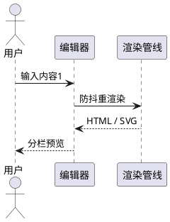
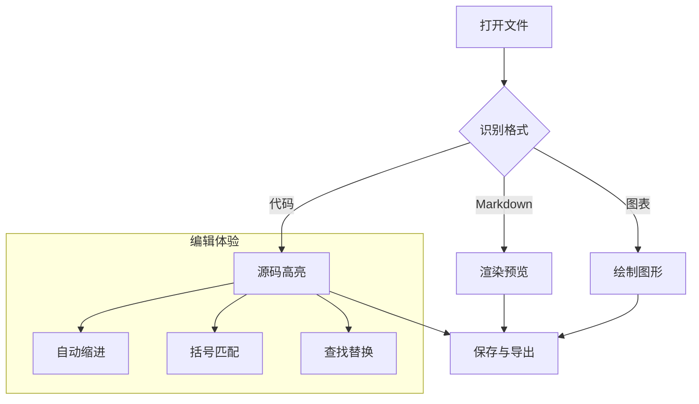

# Panda Live *示例文档*

这是一个用于验证 **Markdown** 渲染的示例文件。

## 文本样式

- **加粗**、*斜体*、~~删除线~~、`行内代码`
- 链接：[示例站点](https://example.com)
- 引用：> A

```c
编辑器的价值在于让人专注于内容本身。
```

## 代码块

```ts
export function greet(name: string): string {
  return `Hello, ${name}!`;
}
```

## 表格

| 格式       | 高亮 | 预览 |
| -------- | -- | -- |
| Markdown | 是  | 是  |
| Python   | 是  | 否  |
| JSON     | 是  | 否  |

## 任务列表

- [x] 支持语法高亮
- [x] 支持自动缩进
- [ ] 支持更多语言

## 图表

PlantUML 围栏代码块（渲染管线时序图）：



Mermaid 围栏代码块



## 公式

行内公式 $a^2 + b^2 = c^2$。

$$
\int_0^1 x^2 \, dx = \frac{1}{3}
$$

## 内嵌 MyST 页签

Markdown 文档中可以直接使用 MyST 围栏指令（反引号写法）：

`````{tab-set}

````{tab-item} 计划
- 第一阶段：基础渲染
- 第二阶段：交互增强
- 第三阶段：导出支持
````

````{tab-item} 实现
```python
def render(markdown: str) -> str:
    return pipeline.run(markdown)
```

解析后经 tab-set / grid 指令展开，再转 HTML。
````

````{tab-item} 说明
页签内容完整支持 Markdown：**加粗**、`代码`、表格均可。
````

`````

冒号写法（官方语法）同样支持：

::::{tab-set}

:::{tab-item} 源码模式
直接编辑 Markdown / MyST 原文。
:::

:::{tab-item} 所见即所得
双击进入富文本编辑。
:::

:::{tab-item} 预览模式
本页签即预览渲染结果。
:::

::::
